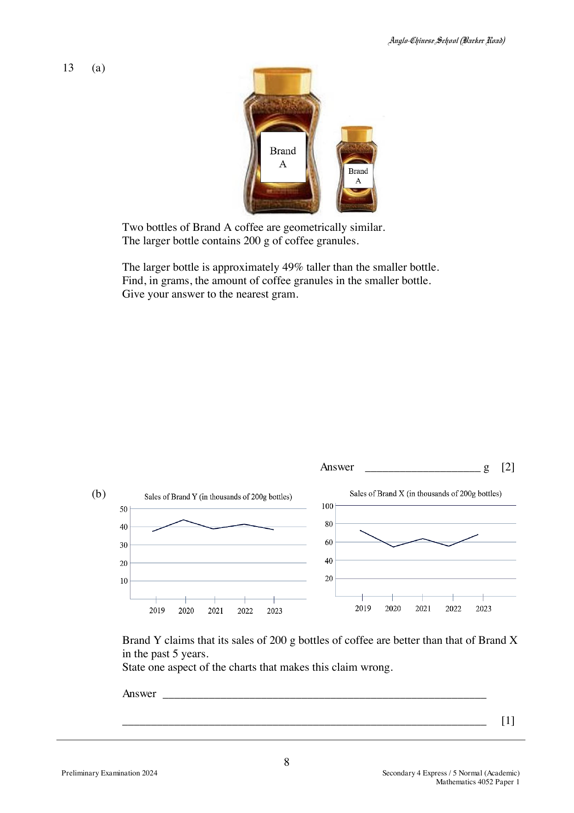

## Question

> **Marks:** 3
> **Page:** 8

(a) Two bottles of Brand A coffee are geometrically similar.
The larger bottle contains 200 g of coffee granules.

The larger bottle is approximately $49\%$ taller than the smaller bottle.
Find, in grams, the amount of coffee granules in the smaller bottle.
Give your answer to the nearest gram.

(b) Brand Y claims that its sales of 200 g bottles of coffee are better than that of Brand X in the past 5 years.
State one aspect of the charts that makes this claim wrong.

## Answer Scheme

(a) $\dfrac{200}{V} = \left(\dfrac{1.49}{1}\right)^{3}$, so $V = 60$ g.

(b) Different vertical scales/intervals are used.
