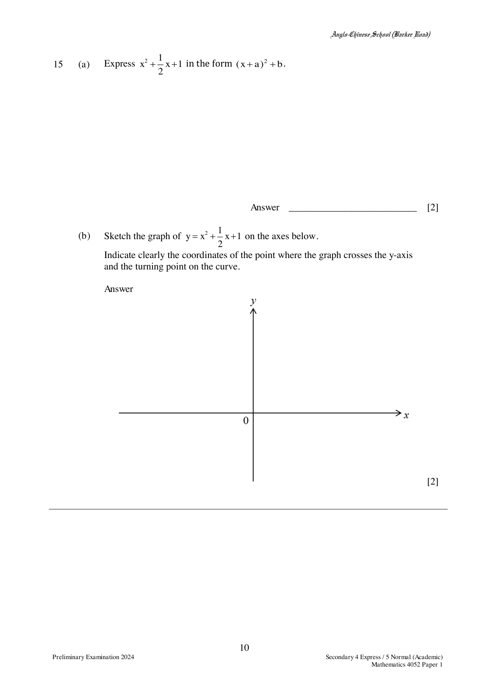

## Question

> **Marks:** 4
> **Page:** 10

(a) Express $x^{2}+\dfrac{1}{2}x+1$ in the form $(x+a)^{2}+b$.

(b) Sketch the graph of $y = x^{2}+\dfrac{1}{2}x+1$ on the axes below.
Indicate clearly the coordinates of the point where the graph crosses the $y$-axis and the turning point on the curve.

## Answer Scheme

(a)

$$
x^{2}+\frac{1}{2}x+1 = \left(x+\frac{1}{4}\right)^{2}+\frac{15}{16}
$$

(b) Sketch the parabola with $y$-intercept $(0, 1)$ and turning point $\left(-\dfrac{1}{4}, \dfrac{15}{16}\right)$.
