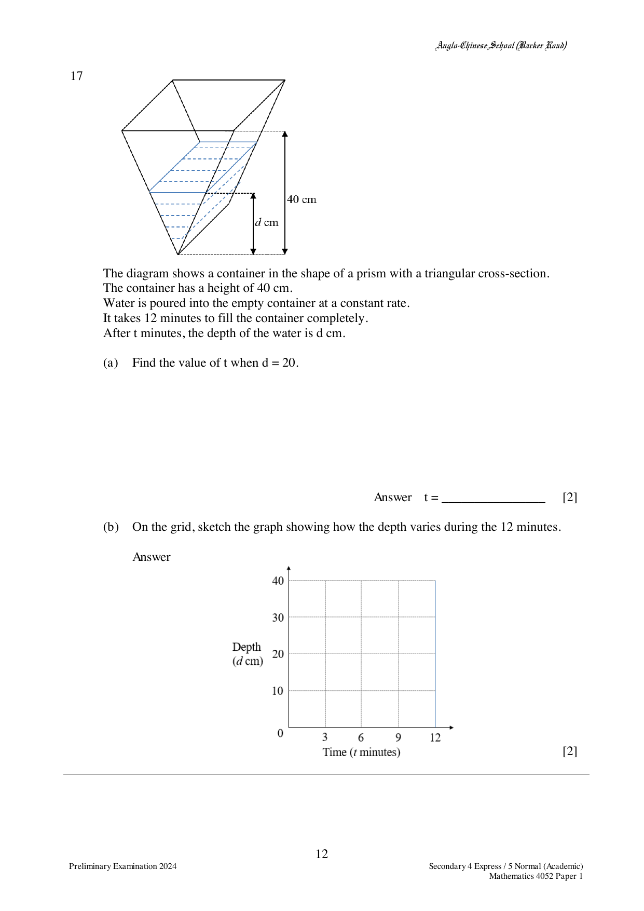

## Question

> **Marks:** 4
> **Page:** 12

The diagram shows a container in the shape of a prism with a triangular cross-section.
The container has a height of 40 cm.
Water is poured into the empty container at a constant rate.
It takes 12 minutes to fill the container completely.
After $t$ minutes, the depth of the water is $d$ cm.

(a) Find the value of $t$ when $d = 20$.

(b) On the grid, sketch the graph showing how the depth varies during the 12 minutes.

## Answer Scheme

(a) The cross-sectional area of the water scales with the square of the depth.

$$
\frac{\frac{1}{2} \times \text{base} \times 20 \times \text{width}}{\frac{1}{2} \times (2 \times \text{base}) \times 40 \times \text{width}} \times 12 = 3
$$

or $\left(\dfrac{20}{40}\right)^{2} \times 12 = 3$ min.

(b) Curve from $(0, 0)$ through $(3, 20)$ to $(12, 40)$, rising more slowly at first (depth proportional to the square root of time).
