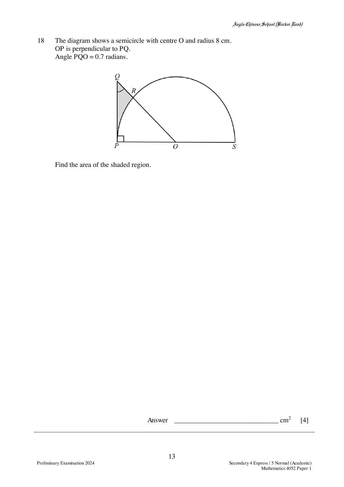

## Question

> **Marks:** 4
> **Page:** 13

The diagram shows a semicircle with centre $O$ and radius 8 cm.
$OP$ is perpendicular to $PQ$.
Angle $PQO = 0.7$ radians.

Find the area of the shaded region.

## Answer Scheme

$$
QP = \frac{8}{\tan 0.7} = 9.4979
$$

Area of triangle $OPQ = \dfrac{1}{2}(8)(9.4979) = 37.992$

Area of sector $= \dfrac{1}{2}(8)^{2}\left(\dfrac{\pi}{2}-0.7\right) = 27.865$

Area of shaded region $= 10.1$ cm$^{2}$.
