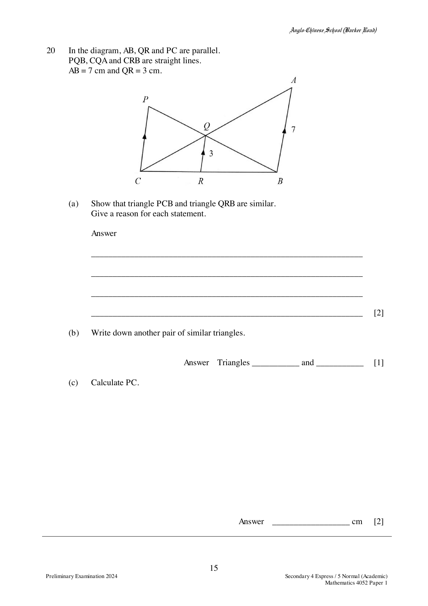

## Question

> **Marks:** 5
> **Page:** 15

In the diagram, $AB$, $QR$ and $PC$ are parallel.
$PQB$, $CQA$ and $CRB$ are straight lines.
$AB = 7$ cm and $QR = 3$ cm.

(a) Show that triangle $PCB$ and triangle $QRB$ are similar.
Give a reason for each statement.

(b) Write down another pair of similar triangles.

(c) Calculate $PC$.

## Answer Scheme

(a) $\angle PBC = \angle QBR$ (common angle).

$\angle BQR = \angle BPC$ (corresponding angles, $PC \parallel QR$).

Triangle $PCB$ and triangle $QRB$ are similar (AA).

(b) Triangles $ABC$ and $QRC$, or triangles $ABQ$ and $CPQ$.

(c)

$$
\frac{CR}{CB} = \frac{3}{7}, \qquad \frac{QR}{PC} = \frac{BR}{BC}
$$

$$
\frac{3}{PC} = \frac{4}{7}, \qquad PC = 5.25
$$
