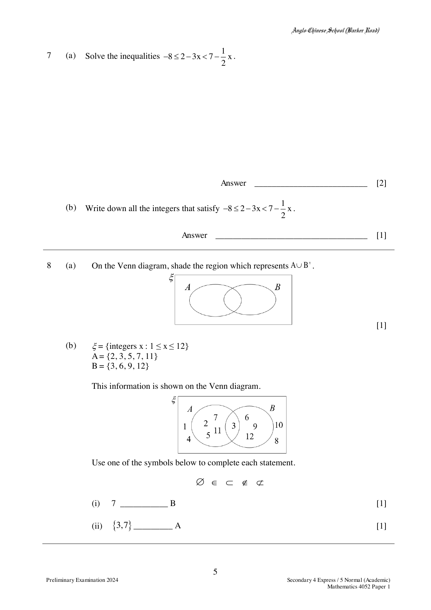

## Question

> **Marks:** 3
> **Page:** 5

(a) On the Venn diagram, shade the region which represents $A \cup B'$.

(b) $\xi = \{\text{integers } x : 1 \le x \le 12\}$

$A = \{2, 3, 5, 7, 11\}$

$B = \{3, 6, 9, 12\}$

This information is shown on the Venn diagram.

Use one of the symbols below to complete each statement.

$\varnothing \quad \in \quad \subset \quad \notin \quad \not\subset$

(i) $7$ ___________ $B$

(ii) $\{3, 7\}$ ___________ $A$

## Answer Scheme

(a) Shade the whole of set $A$, together with the region that is outside both $A$ and $B$ (that is, $A \cup B'$).

(b) (i) $7 \notin B$

(ii) $\{3, 7\} \subset A$
