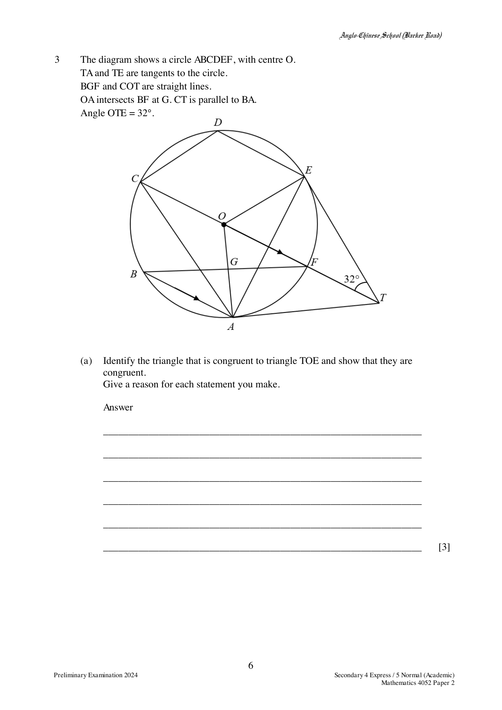

## Question

> **Marks:** 10
> **Page:** 6–7

The diagram shows a circle $ABCDEF$, with centre $O$.
$TA$ and $TE$ are tangents to the circle.
$BGF$ and $COT$ are straight lines.
$OA$ intersects $BF$ at $G$. $CT$ is parallel to $BA$.
Angle $OTE = 32^{\circ}$.

(a) Identify the triangle that is congruent to triangle $TOE$ and show that they are congruent.
Give a reason for each statement you make.

(b) Find, giving reasons for each step of your working,

(i) angle $OFG$,

(ii) angle $CDE$.

(c) Explain why points $O$, $E$, $T$ and $A$ can also be points on the circumference of another circle.

## Answer Scheme

(a) One possible answer:

- $ET = AT$ (tangents from an external point are equal)
- $TO$ is common
- $OE = OA$ (radii of the circle)

Triangle $TOA$ is congruent to triangle $TOE$ (SSS).

Another possible answer:

- $\angle TAO = \angle TEO = 90^{\circ}$ (tangent perpendicular to radius)
- $TO$ is common
- $OE = OA$ (radii of the circle)

Triangle $TOA$ is congruent to triangle $TOE$ (RHS).

(b) (i) $\angle AOT = (180-90-32)^{\circ} = 58^{\circ}$ (tangent perpendicular to radius).

$\angle ABF = \dfrac{1}{2}\angle AOT = \dfrac{1}{2}(58^{\circ}) = 29^{\circ}$ (angle at the centre is twice the angle at the circumference).

$\angle OFG = \angle ABF = 29^{\circ}$ (alternate angles, $OF \parallel BA$).

(ii) $\angle ACF = \angle ABF = 29^{\circ}$ (angles in the same segment).

$\angle CAE = 180^{\circ}-90^{\circ}-29^{\circ} = 61^{\circ}$ ($OT$ is the perpendicular bisector of chord $AE$).

$\angle CDE = 180^{\circ}-61^{\circ} = 119^{\circ}$ (angles in opposite segments).

(c) As $\angle OET$ and $\angle OAT$ are right angles, by the property of the angle in a semicircle, $OT$ is a diameter and points $E$ and $A$ lie on the circumference. $O$, $E$, $T$ and $A$ are thus four points on the circumference of this circle.

Or $\angle AOE+\angle ATE = (58 \times 2)+(32 \times 2) = 180^{\circ}$, and $\angle OET+\angle OAT = 180^{\circ}$. By the property of angles in opposite segments, $O$, $E$, $T$ and $A$ are four points on the circumference of this circle.
