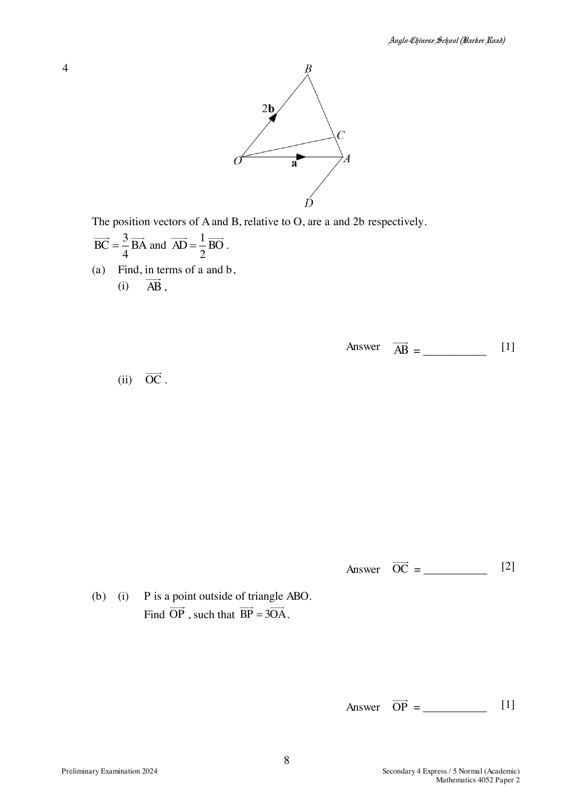

## Question

> **Marks:** 8
> **Page:** 8–9

The position vectors of $A$ and $B$, relative to $O$, are $\mathbf{a}$ and $2\mathbf{b}$ respectively.

$$
\overrightarrow{BC} = \frac{3}{4}\overrightarrow{BA} \quad \text{and} \quad \overrightarrow{AD} = \frac{1}{2}\overrightarrow{BO}.
$$

(a) Find, in terms of $\mathbf{a}$ and $\mathbf{b}$,

(i) $\overrightarrow{AB}$,

(ii) $\overrightarrow{OC}$.

(b) (i) $P$ is a point outside triangle $ABO$.
Find $\overrightarrow{OP}$, such that $\overrightarrow{BP} = 3\overrightarrow{OA}$.

(ii) Show that $O$, $C$ and $P$ lie on a straight line.

(c) Find the ratio

(i) area of triangle $OCB$ : area of triangle $OCA$,

(ii) area of triangle $OAC$ : area of triangle $OAD$.

## Answer Scheme

(a) (i) $\overrightarrow{AB} = 2\mathbf{b}-\mathbf{a}$

(ii)

$$
\overrightarrow{BC} = -\frac{3}{4}\overrightarrow{BA} = -\frac{3}{4}(2\mathbf{b}-\mathbf{a})
$$

$$
\overrightarrow{OC} = \overrightarrow{OB}+\overrightarrow{BC} = 2\mathbf{b}-\frac{3}{4}(2\mathbf{b}-\mathbf{a}) = \frac{3}{4}\mathbf{a}+\frac{1}{2}\mathbf{b}
$$

(b) (i) $\overrightarrow{OP} = \overrightarrow{OB}+\overrightarrow{BP} = 2\mathbf{b}+3\mathbf{a}$

(ii) $\overrightarrow{OP} = 3\mathbf{a}+2\mathbf{b}$ and $\overrightarrow{OC} = \dfrac{1}{4}(3\mathbf{a}+2\mathbf{b})$.

As $\overrightarrow{OC} = \dfrac{1}{4}\overrightarrow{OP}$, and $O$ is a common point, $O$, $C$ and $P$ lie on a straight line.

(c) (i) $3:1$

(ii) Area of $OAC$ : area of $OAB$ : area of $OAD$ is built as $1:4$, then $2:1$, then $4:2$. Therefore area of $OAC$ : area of $OAD$ is $1:2$.
