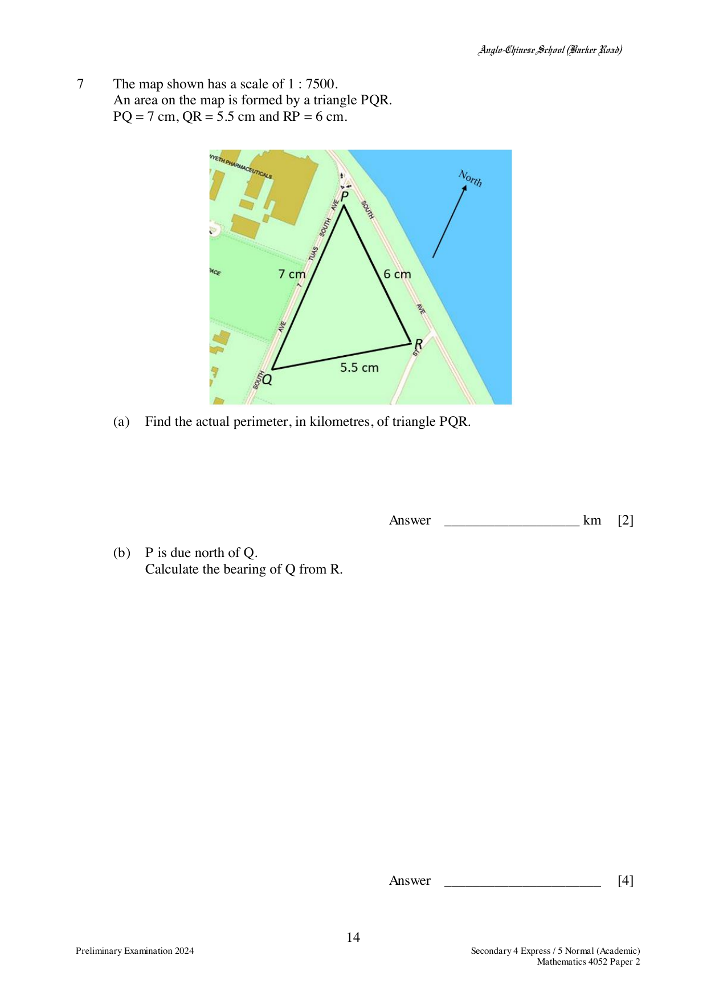

## Question

> **Marks:** 13
> **Page:** 14–15

The map shown has a scale of $1:7500$.
An area on the map is formed by a triangle $PQR$.
$PQ = 7$ cm, $QR = 5.5$ cm and $RP = 6$ cm.

(a) Find the actual perimeter, in kilometres, of triangle $PQR$.

(b) $P$ is due north of $Q$.
Calculate the bearing of $Q$ from $R$.

(c) Calculate, in square metres, the actual area of triangle $PQR$.

(d) A drone flies along the line $QP$ at a vertical height of 75 m.
Find the greatest angle of elevation of the drone from $R$.

## Answer Scheme

(a) $18.5 \times 7500 \div 100000 = 1.3875$ km.

(b)

$$
6^{2} = 7^{2}+5.5^{2}-2(7)(5.5)\cos\angle PQR
$$

$$
\cos\angle PQR = \frac{-43.25}{-77}
$$

$\angle PQR = 55.827^{\circ}$.

Bearing of $Q$ from $R$ is $180+55.827 = 235.8^{\circ}$.

(c)

$$
\text{Area of } PQR = \frac{1}{2}(7 \times 75)(5.5 \times 75)\sin 55.827^{\circ} = 89585 \text{ m}^{2} = 89600 \text{ m}^{2}.
$$

(d) Let the shortest distance from $R$ to $PQ$ be $RX$.

$$
\sin\angle PQR = \frac{RX}{QR}, \qquad \sin 55.827^{\circ} = \frac{RX}{412.5}
$$

$RX = 341.28$ m.

Let the greatest angle of elevation be $y$.

$$
\tan y = \frac{75}{RX}, \qquad y = 12.4^{\circ}
$$
