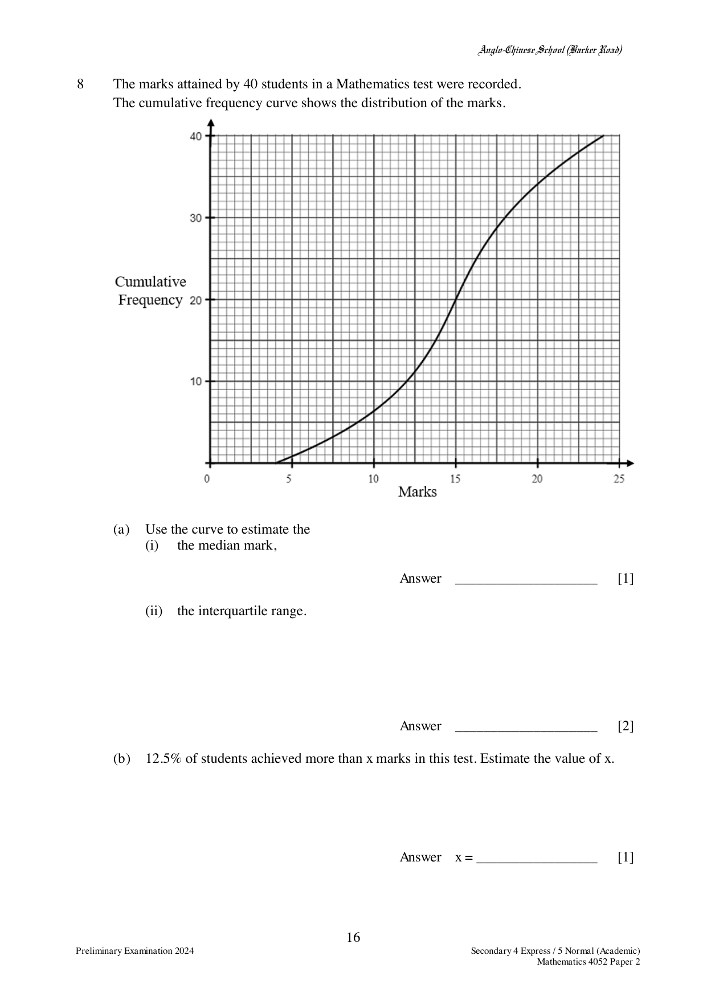
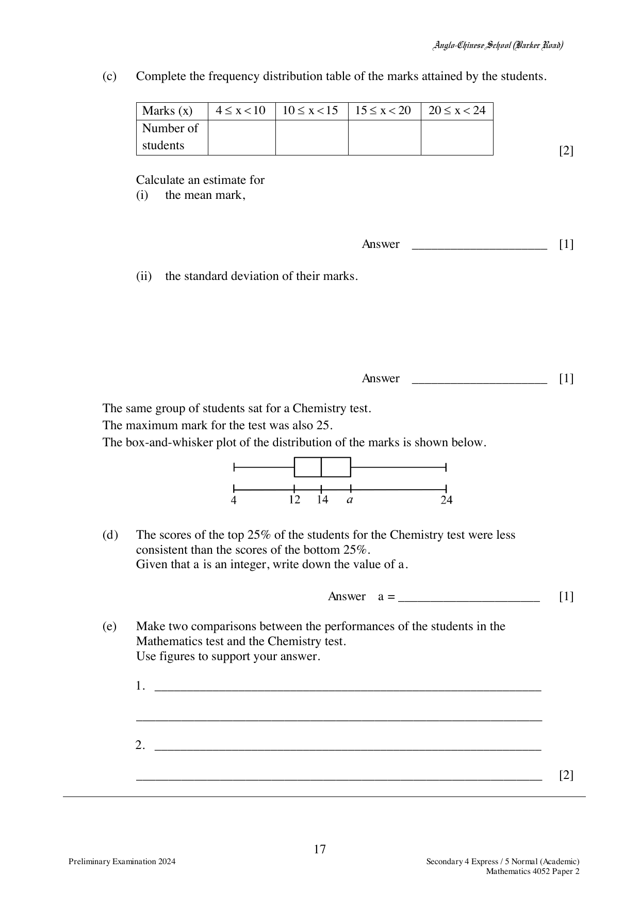

## Question

> **Marks:** 11
> **Page:** 16–17

The marks attained by 40 students in a Mathematics test were recorded.
The cumulative frequency curve shows the distribution of the marks.

(a) Use the curve to estimate

(i) the median mark,

(ii) the interquartile range.

(b) $12.5\%$ of students achieved more than $x$ marks in this test. Estimate the value of $x$.

(c) Complete the frequency distribution table of the marks attained by the students.

| Marks ($x$) | $4 \le x < 10$ | $10 \le x < 15$ | $15 \le x < 20$ | $20 \le x < 24$ |
| --- | --- | --- | --- | --- |
| Number of students | | | | |

Calculate an estimate for

(i) the mean mark,

(ii) the standard deviation of their marks.

The same group of students sat for a Chemistry test.
The maximum mark for the test was also 25.
The box-and-whisker plot of the distribution of the marks is shown below.

The five labels on the plot, from left to right, are 4, 12, 14, $a$ and 24.

(d) The scores of the top $25\%$ of the students for the Chemistry test were less consistent than the scores of the bottom $25\%$.
Given that $a$ is an integer, write down the value of $a$.

(e) Make two comparisons between the performances of the students in the Mathematics test and the Chemistry test.
Use figures to support your answer.

## Answer Scheme

(a) (i) 15 marks

(ii) $18-12 = 6$ marks

(b) $20.5$ marks

(c)

| Marks ($x$) | $4 \le x < 10$ | $10 \le x < 15$ | $15 \le x < 20$ | $20 \le x < 24$ |
| --- | --- | --- | --- | --- |
| Number of students | 6 | 14 | 14 | 6 |

(i)

$$
\frac{(6 \times 7)+(14 \times 12.5)+(14 \times 17.5)+(6 \times 22)}{40} = 14.85
$$

(ii) $4.62$

Alternative reading of the curve:

| Marks ($x$) | $4 \le x < 10$ | $10 \le x < 15$ | $15 \le x < 20$ | $20 \le x < 24$ |
| --- | --- | --- | --- | --- |
| Number of students | 7 | 13 | 14 | 6 |

Mean $14.7125$, standard deviation $4.76$. (The scheme writes the same midpoint products as the first reading against this second frequency row.)

(d) $a = 15$

(e) The students performed better in Mathematics as the median score (15 marks) was higher than Chemistry’s (14 marks).

The students performed more consistently in Chemistry as the interquartile range (3 marks) is lower than Mathematics (6 marks).
