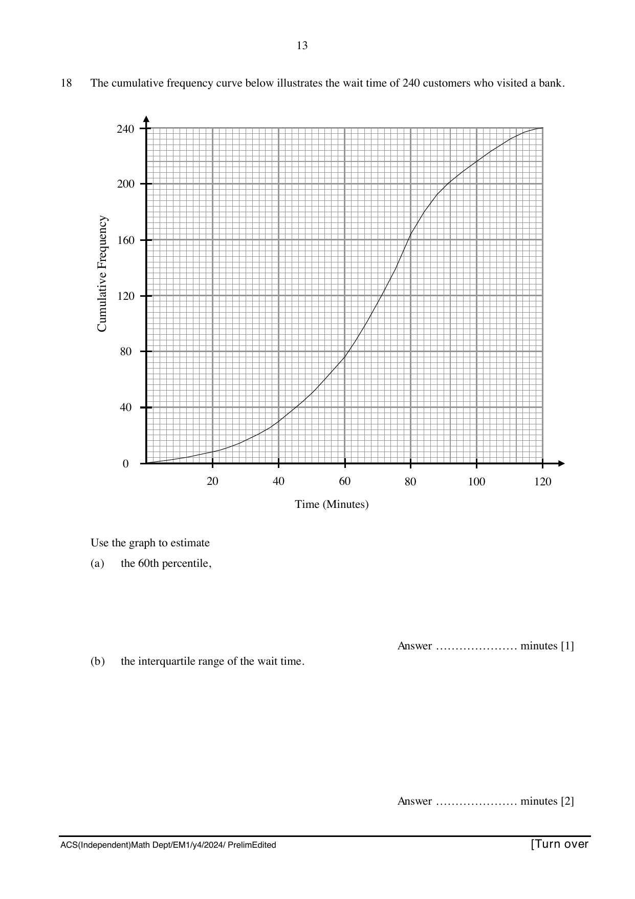

## Question

> **Marks:** 7
> **Page:** 13–14

The cumulative frequency curve below illustrates the wait time of $240$ customers who visited a bank.

Use the graph to estimate

(a) the 60th percentile, [1]

(b) the interquartile range of the wait time. [2]

(c) Only $10\%$ of the customers complained about the long wait time they experienced. What was the minimum wait time for these customers? [2]

(d) Two customers are chosen at random. Find the probability that one customer waited for less than or equal to $60$ minutes and the other waited for more than $100$ minutes. [2]
