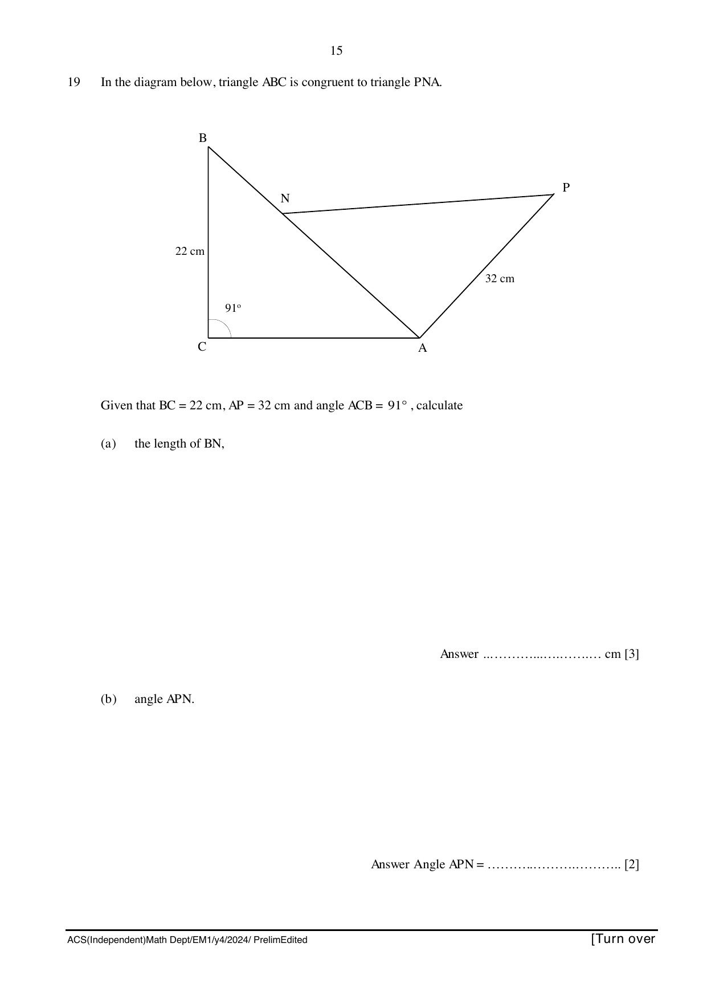

## Question

> **Marks:** 5
> **Page:** 15

In the diagram below, triangle $ABC$ is congruent to triangle $PNA$.

Given that $BC = 22$ cm, $AP = 32$ cm and angle $ACB = 91^{\circ}$, calculate

(a) the length of $BN$, [3]

(b) angle $APN$. [2]
