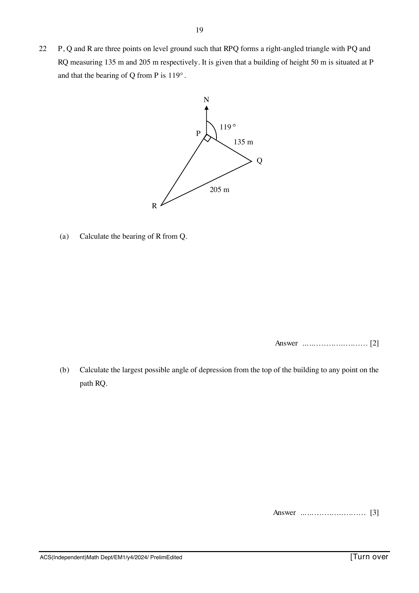

## Question

> **Marks:** 5
> **Page:** 19

$P$, $Q$ and $R$ are three points on level ground such that $RPQ$ forms a right-angled triangle with $PQ$ and $RQ$ measuring $135$ m and $205$ m respectively. It is given that a building of height $50$ m is situated at $P$ and that the bearing of $Q$ from $P$ is $119^{\circ}$.

(a) Calculate the bearing of $R$ from $Q$. [2]

(b) Calculate the largest possible angle of depression from the top of the building to any point on the path $RQ$. [3]
