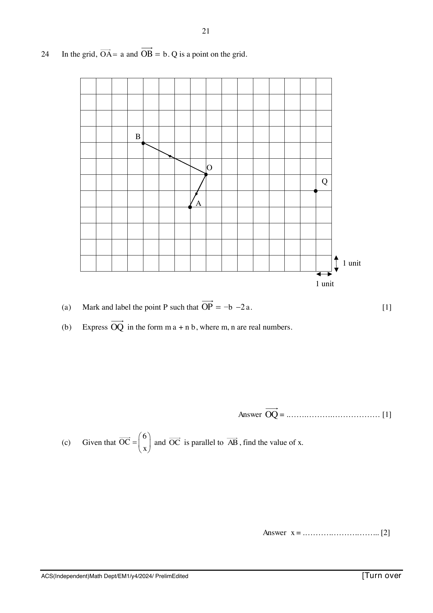

## Question

> **Marks:** 4
> **Page:** 21

In the grid, $\overrightarrow{OA} = \mathbf{a}$ and $\overrightarrow{OB} = \mathbf{b}$. $Q$ is a point on the grid.

(a) Mark and label the point $P$ such that $\overrightarrow{OP} = -\mathbf{b} - 2\mathbf{a}$. [1]

(b) Express $\overrightarrow{OQ}$ in the form $m\mathbf{a} + n\mathbf{b}$, where $m$, $n$ are real numbers. [1]

(c) Given that $\overrightarrow{OC} = \begin{pmatrix} 6 \\ x \end{pmatrix}$ and $\overrightarrow{OC}$ is parallel to $\overrightarrow{AB}$, find the value of $x$. [2]
