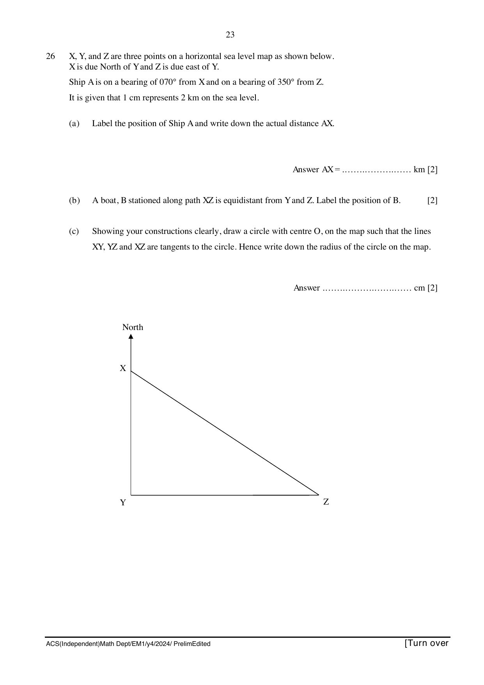

## Question

> **Marks:** 6
> **Page:** 23

$X$, $Y$, and $Z$ are three points on a horizontal sea level map as shown below.
$X$ is due North of $Y$ and $Z$ is due east of $Y$.
Ship A is on a bearing of $070^{\circ}$ from $X$ and on a bearing of $350^{\circ}$ from $Z$.
It is given that $1$ cm represents $2$ km on the sea level.

(a) Label the position of Ship A and write down the actual distance $AX$. [2]

(b) A boat, $B$ stationed along path $XZ$ is equidistant from $Y$ and $Z$. Label the position of $B$. [2]

(c) Showing your constructions clearly, draw a circle with centre $O$, on the map such that the lines $XY$, $YZ$ and $XZ$ are tangents to the circle. Hence write down the radius of the circle on the map. [2]

