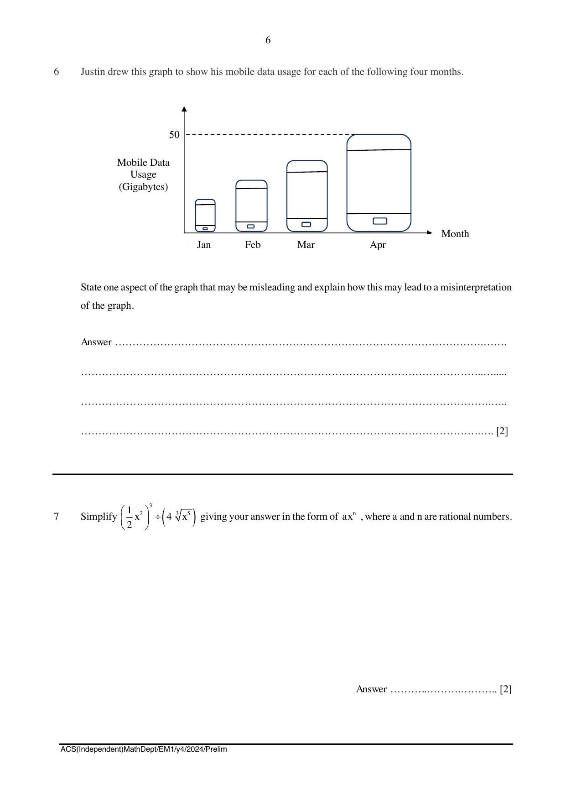

## Question

> **Marks:** 2
> **Page:** 6

Justin drew this graph to show his mobile data usage for each of the following four months.

State one aspect of the graph that may be misleading and explain how this may lead to a misinterpretation of the graph. [2]
