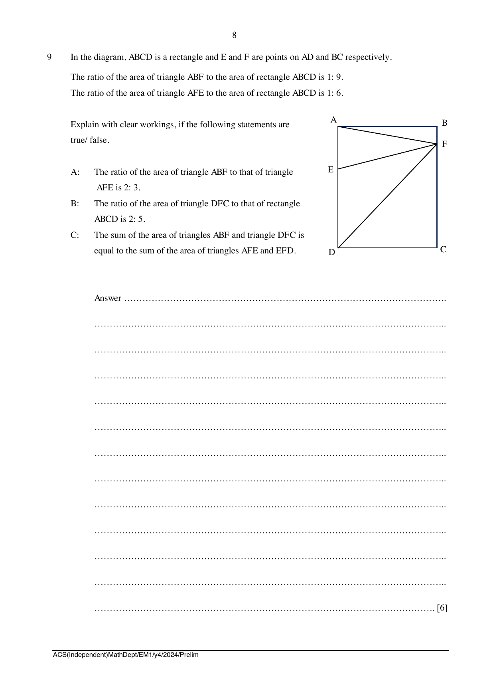

## Question

> **Marks:** 6
> **Page:** 8

In the diagram, $ABCD$ is a rectangle and $E$ and $F$ are points on $AD$ and $BC$ respectively.

The ratio of the area of triangle $ABF$ to the area of rectangle $ABCD$ is $1:9$.
The ratio of the area of triangle $AFE$ to the area of rectangle $ABCD$ is $1:6$.

Explain with clear workings, if the following statements are true/ false.

A: The ratio of the area of triangle $ABF$ to that of triangle $AFE$ is $2:3$.

B: The ratio of the area of triangle $DFC$ to that of rectangle $ABCD$ is $2:5$.

C: The sum of the area of triangles $ABF$ and triangle $DFC$ is equal to the sum of the area of triangles $AFE$ and $EFD$. [6]
