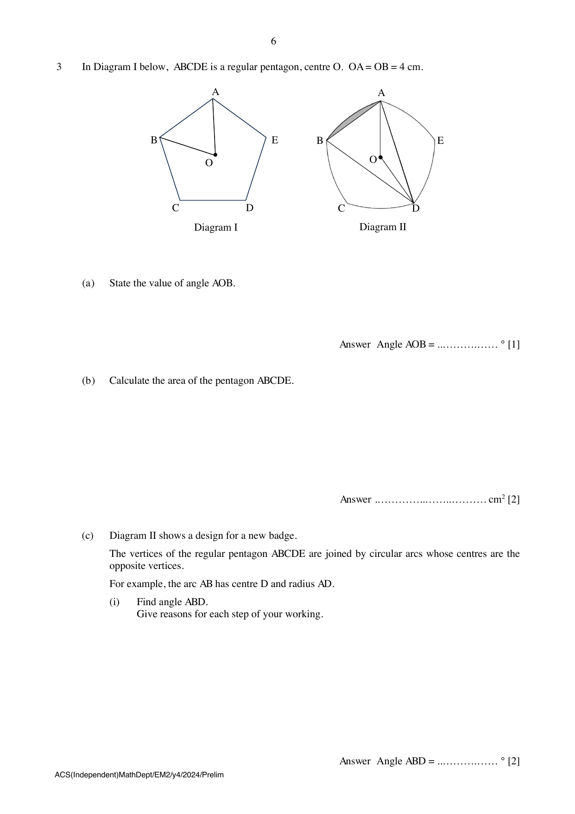

## Question

> **Marks:** 12
> **Page:** 6–7

In Diagram I below, $ABCDE$ is a regular pentagon, centre $O$. $OA = OB = 4$ cm.

(a) State the value of angle $AOB$. [1]

(b) Calculate the area of the pentagon $ABCDE$. [2]

(c) Diagram II shows a design for a new badge.
The vertices of the regular pentagon $ABCDE$ are joined by circular arcs whose centres are the opposite vertices.
For example, the arc $AB$ has centre $D$ and radius $AD$.

(i) Find angle $ABD$.
Give reasons for each step of your working. [2]

(ii) Show that the length of $BD$ is approximately $7.61$ cm. [2]

(iii) Calculate the area of the shaded segment in Diagram II. [3]

(iv) Calculate the area of the face $ABCDE$ of the badge. [2]
