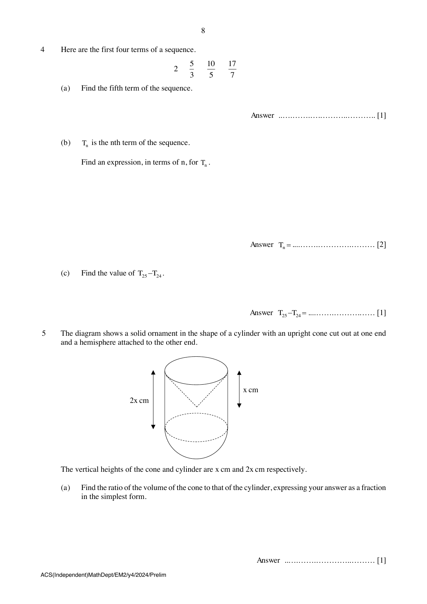

## Question

> **Marks:** 9
> **Page:** 8–9

The diagram shows a solid ornament in the shape of a cylinder with an upright cone cut out at one end and a hemisphere attached to the other end.

The vertical heights of the cone and cylinder are $x$ cm and $2x$ cm respectively.

(a) Find the ratio of the volume of the cone to that of the cylinder, expressing your answer as a fraction in the simplest form. [1]

(b) If the volume of the cylinder is $345$ cm$^{3}$ and its height is $8$ cm, calculate

(i) the radius of the cylinder, [2]

(ii) the curved surface area of the cone, [3]

(iii) the quantity of paint needed to paint the exterior of the ornament with a $0.2$ mm thick coat of paint. [3]
