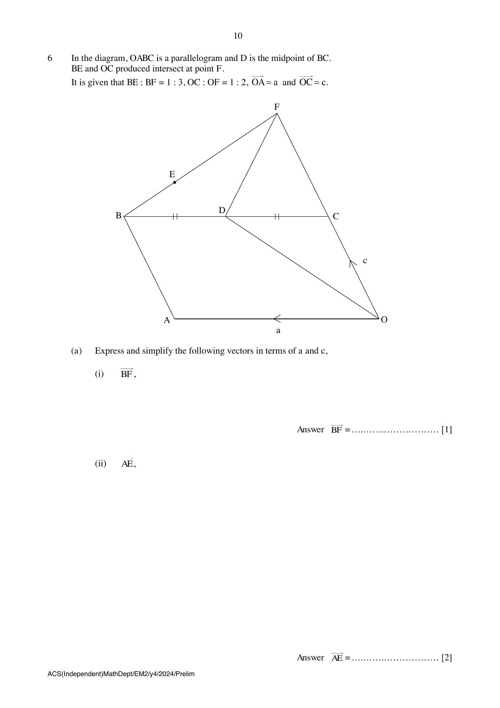

## Question

> **Marks:** 9
> **Page:** 10–11

In the diagram, $OABC$ is a parallelogram and $D$ is the midpoint of $BC$.
$BE$ and $OC$ produced intersect at point $F$.
It is given that $BE:BF = 1:3$, $OC:OF = 1:2$, $\overrightarrow{OA} = \mathbf{a}$ and $\overrightarrow{OC} = \mathbf{c}$.

(a) Express and simplify the following vectors in terms of $\mathbf{a}$ and $\mathbf{c}$,

(i) $\overrightarrow{BF}$, [1]

(ii) $\overrightarrow{AE}$, [2]

(iii) $\overrightarrow{OD}$. [1]

(b) Determine, with clear working shown, whether points $O$, $D$ and $E$ lie on a straight line. [3]

(c) Find the value of $\dfrac{\text{area of triangle } CDE}{\text{area of parallelogram } OABC}$. [2]
