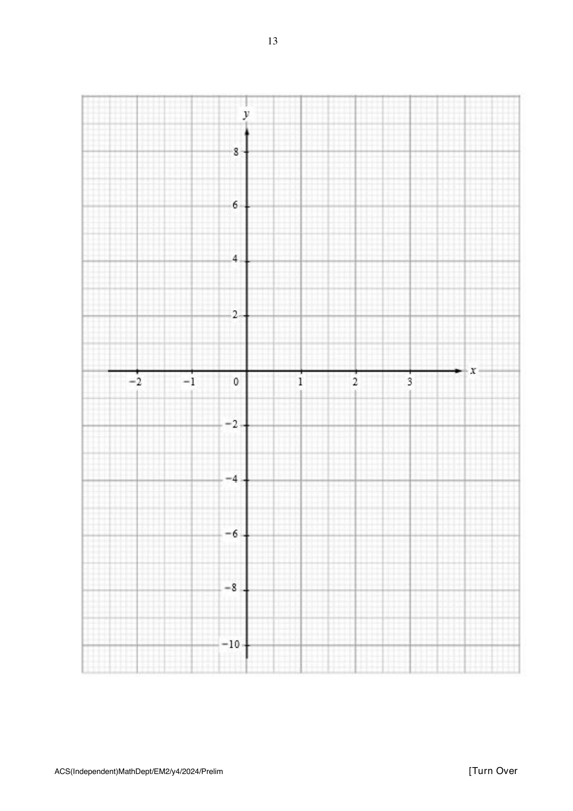

## Question

> **Marks:** 12
> **Page:** 12–13

(a) Complete the table of values for $y = 2x + \dfrac{1}{x^{2}} - 4$.
Values are given to two decimal places where appropriate. [1]

| $x$ | $-2$ | $-1$ | $-0.5$ | $-0.3$ | $0.3$ | $0.5$ | $1$ | $2$ | $3$ |
| --- | --- | --- | --- | --- | --- | --- | --- | --- | --- |
| $y$ | $-7.75$ | $-5$ | $-1$ | $6.51$ | $7.71$ |  | $-1$ | $0.25$ | $2.1$ |

(b) On the grid opposite, draw the graph of $y = 2x + \dfrac{1}{x^{2}} - 4$ for $-2 \leq x \leq 3$. [3]

(c) (i) $y = b$ cuts the graph of $y = 2x + \dfrac{1}{x^{2}} - 4$ at one point for $-2 \leq x \leq 3$, state the range of values of $b$. [1]

(ii) On the same grid, draw the graph of $3y - 5x = 4$ for $-2 \leq x \leq 3$. [2]

(iii) Write down the $x$-coordinates of the points where the graph of $3y - 5x = 4$ intersects the curve for $-2 \leq x \leq 3$. [2]

(iv) These values of $x$ are solutions of the equation $x^{3} + Ax^{2} + B = 0$.
Find the value of $A$ and the value of $B$. [3]
