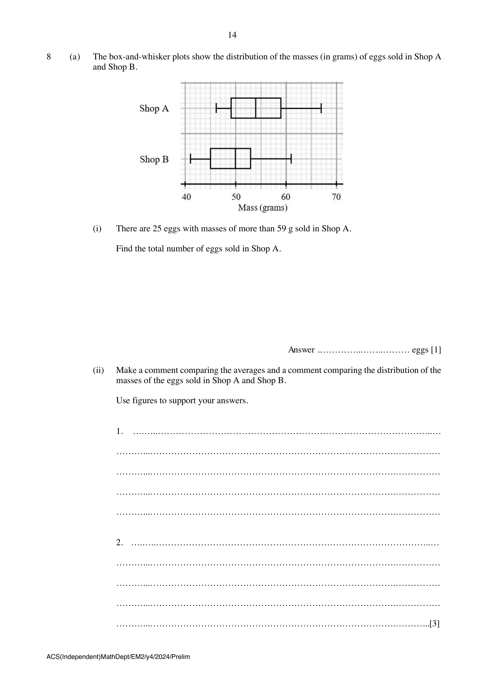

## Question

> **Marks:** 9
> **Page:** 14–15

(a) The box-and-whisker plots show the distribution of the masses (in grams) of eggs sold in Shop A and Shop B.

(i) There are $25$ eggs with masses of more than $59$ g sold in Shop A.

Find the total number of eggs sold in Shop A. [1]

(ii) Make a comment comparing the averages and a comment comparing the distribution of the masses of the eggs sold in Shop A and Shop B.

Use figures to support your answers. [3]

(b) In a sample of $80$ eggs, $4$ are cracked.

(i) One egg is selected from the sample at random.

Find the probability that the egg is cracked. [1]

(ii) Two eggs are selected from the sample at random.

Find the probability that both eggs are cracked. [2]

(iii) Three eggs are selected from the sample at random.

Find the probability that at least one egg is cracked. [2]
