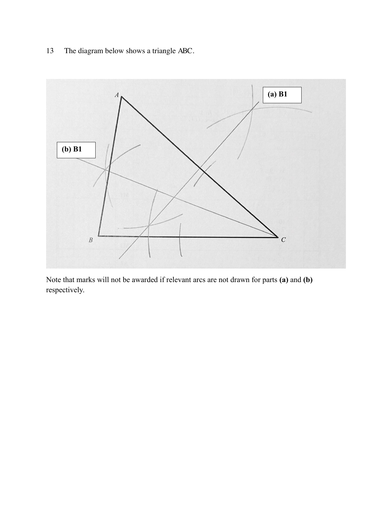

## Question

> **Marks:** 2
> **Page:** 12

The diagram below shows a triangle $ABC$.

**(a)** Construct the perpendicular bisector of $AC$. [1]

**(b)** Construct the bisector of angle $BCA$. [1]

## Answer Scheme

Marks are not awarded if the relevant arcs are not drawn.

