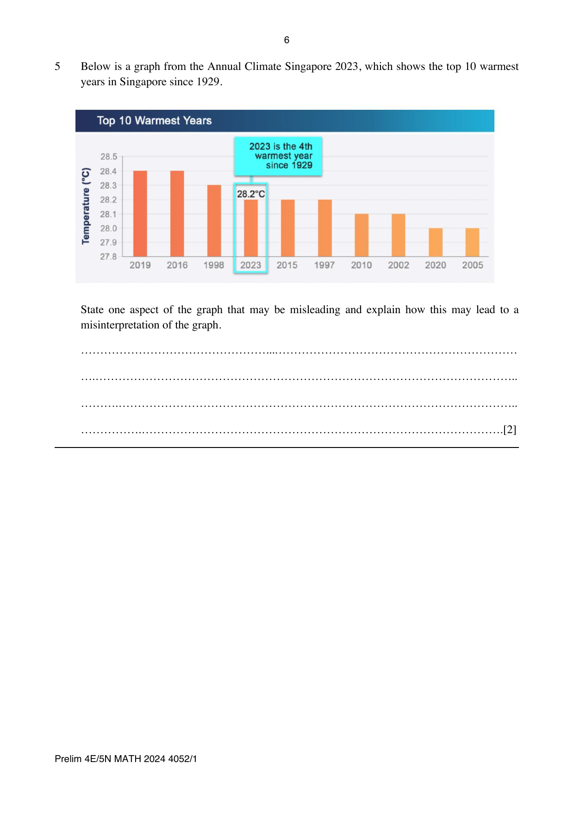

## Question

> **Marks:** 2
> **Page:** 6

Below is a graph from the Annual Climate Singapore 2023, which shows the top 10 warmest years in Singapore since 1929.

State one aspect of the graph that may be misleading and explain how this may lead to a misinterpretation of the graph. [2]

## Answer Scheme

The size/height of the bar graph. Stating that the graph does not start from zero is accepted too.

It can be misleading because, for example, the size/height of the graph in 2019 is twice that of the graph in 2010 but this does not represent their actual temperatures. A relevant example has to be given.
