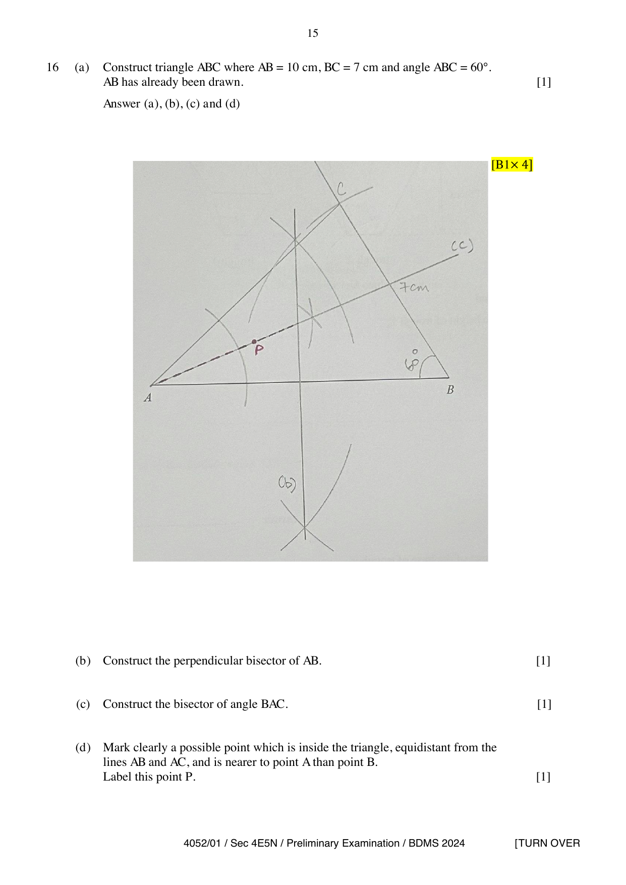

## Question

> **Marks:** 4
> **Page:** 15

**(a)** Construct triangle $ABC$ where $AB=10\text{ cm}$, $BC=7\text{ cm}$ and $\angle ABC=60^{\circ}$. $AB$ has already been drawn. [1]

**(b)** Construct the perpendicular bisector of $AB$. [1]

**(c)** Construct the bisector of angle $BAC$. [1]

**(d)** Mark clearly a possible point which is inside the triangle, equidistant from the lines $AB$ and $AC$, and is nearer to point $A$ than point $B$. Label this point $P$. [1]

## Answer Scheme

[B1] for each of (a), (b), (c) and (d).

The scheme shows the constructed triangle $ABC$ with $BC=7\text{ cm}$ and $\angle ABC=60^{\circ}$, the perpendicular bisector of $AB$, the bisector of $\angle BAC$, and a point $P$ inside the triangle on that angle bisector and on the side of the perpendicular bisector nearer to $A$.

