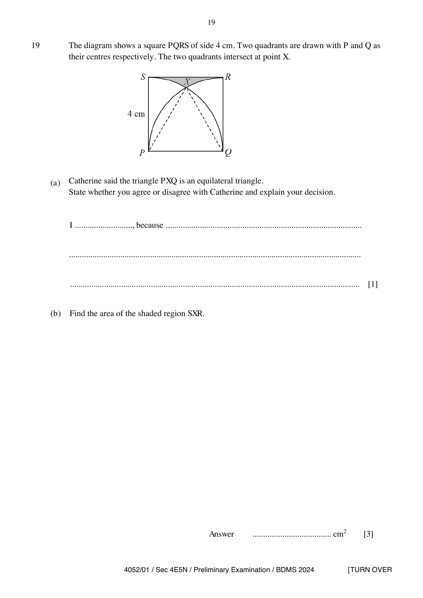

## Question

> **Marks:** 4
> **Page:** 19

The diagram shows a square $PQRS$ of side $4\text{ cm}$. Two quadrants are drawn with $P$ and $Q$ as their centres respectively. The two quadrants intersect at point $X$.

**(a)** Catherine said the triangle $PXQ$ is an equilateral triangle. State whether you agree or disagree with Catherine and explain your decision. [1]

**(b)** Find the area of the shaded region $SXR$. [3]

## Answer Scheme

**(a)** Agree, because $PX=QX=PQ=$ radius of the two same size quadrants. [B1]

**(b)** Area of square minus $2\times$(area of sector $SPX$) minus area of triangle $PXQ$.

$$
4\times 4-2\left(\frac{30^{\circ}}{360^{\circ}}\times\pi\times 4^{2}\right)-\frac{1}{2}\times 4^{2}\times\sin 60^{\circ}
$$

[M2]

$$
=0.694\text{ cm}^{2}
$$

[A1]
