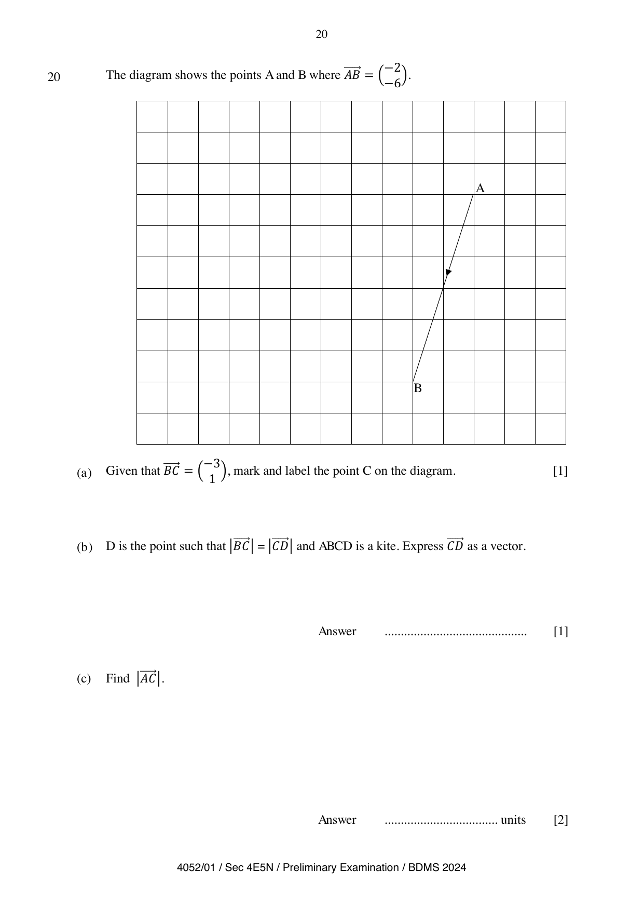

## Question

> **Marks:** 4
> **Page:** 20

The diagram shows the points $A$ and $B$ where $\overrightarrow{AB}=\begin{pmatrix}-2\\ -6\end{pmatrix}$.

**(a)** Given that $\overrightarrow{BC}=\begin{pmatrix}-3\\ 1\end{pmatrix}$, mark and label the point $C$ on the diagram. [1]

**(b)** $D$ is the point such that $|\overrightarrow{BC}|=|\overrightarrow{CD}|$ and $ABCD$ is a kite. Express $\overrightarrow{CD}$ as a vector. [1]

**(c)** Find $|\overrightarrow{AC}|$. [2]

## Answer Scheme

**(a)** Point $C$ marked on the grid from $\overrightarrow{BC}=\begin{pmatrix}-3\\ 1\end{pmatrix}$. [B1]

**(b)**

$$
\overrightarrow{CD}=\begin{pmatrix}-1\\ 3\end{pmatrix}
$$

[B1]

**(c)**

$$
|\overrightarrow{AC}|=\sqrt{(-5)^{2}+(-5)^{2}}
$$

[M1]

$$
=7.07
$$

[A1]
