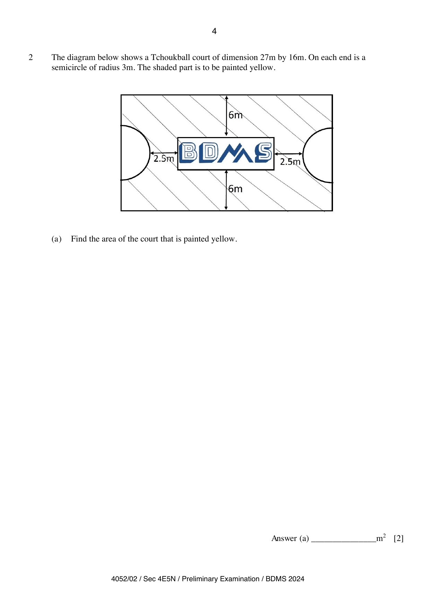

## Question

> **Marks:** 5
> **Page:** 4–5

The diagram below shows a Tchoukball court of dimension $27\text{ m}$ by $16\text{ m}$. On each end is a semicircle of radius $3\text{ m}$. The shaded part is to be painted yellow.

**(a)** Find the area of the court that is painted yellow. [2]

**(b)** $3$ workers can paint the court in $5$ days. After painting the first day, the workers had to stop on the second and third day because it was raining. Teachers, Mr Chin and Mr Lee, decided to help with the painting on the fourth and fifth day. Assuming the $3$ workers and $2$ teachers paint at the same rate, can they finish painting the shaded area on the fifth day? Show your working clearly. [3]

## Answer Scheme

**(a)** Area that is painted yellow

$$
=(27\times 16)-(\pi\times 3^{2})-(16\times 4)
$$

[M1]

$$
=339.726=340\text{ m}^{2}\text{ (3 s.f.)}
$$

[A1]

**(b)** Man-days needed to paint the court $=5\times 3=15$ [M1]

Man-days needed after the first day $=15-(3\times 1)=12$.

Number of people needed for the fourth and fifth days $=12\div 2=6$ [M1]

Number of workers and teachers painting on the fourth and fifth days $=5$.

Therefore they cannot finish painting on the fifth day. [A1]
