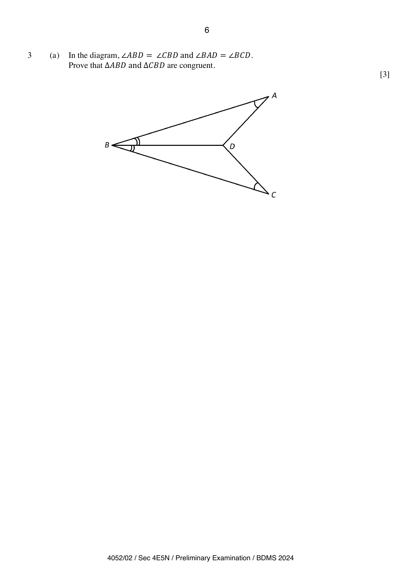
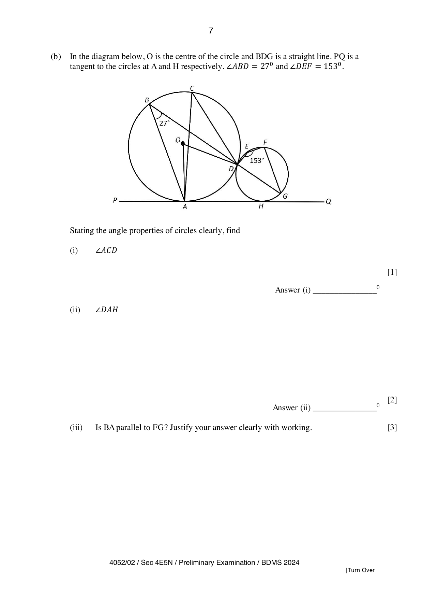

## Question

> **Marks:** 9
> **Page:** 6–7

**(a)** In the diagram, $\angle ABD=\angle CBD$ and $\angle BAD=\angle BCD$. Prove that $\triangle ABD$ and $\triangle CBD$ are congruent.

[3]

**(b)** In the diagram below, $O$ is the centre of the circle and $BDG$ is a straight line. $PQ$ is a tangent to the circles at $A$ and $H$ respectively. $\angle ABD=27^{\circ}$ and $\angle DEF=153^{\circ}$.

Stating the angle properties of circles clearly, find

**(i)** $\angle ACD$ [1]

**(ii)** $\angle DAH$ [2]

**(iii)** Is $BA$ parallel to $FG$? Justify your answer clearly with working. [3]

## Answer Scheme

**(a)** In $\triangle ABD$ and $\triangle CBD$,

$BD$ is common.

$\angle ABD=\angle CBD$ (given).

$\angle BAD=\angle BCD$ (given).

[B2] for $3$ correct statements. [B1] for $2$ correct statements.

Therefore $\triangle ABD$ and $\triangle CBD$ are congruent (AAS). [B1]

**(b) (i)** $\angle ACD=27^{\circ}$ (angle in the same segment). [B1]

**(ii)** $\angle OAH=90^{\circ}$ (radius perpendicular to tangent).

$\angle AOD=54^{\circ}$ (angle at the centre $=2\times$ angle at the circumference).

[M1] for either property.

$$
\angle OAD=\frac{180^{\circ}-54^{\circ}}{2}=63^{\circ}
$$

$$
\angle DAH=90^{\circ}-63^{\circ}=27^{\circ}
$$

[A1]

**(iii)**

$$
\angle DGF=180^{\circ}-153^{\circ}=27^{\circ}
$$

(angles in opposite segments) [M1]

Since $\angle ABD=\angle DGF=27^{\circ}$ [M1], by the converse of alternate angles, $BA$ is parallel to $FG$. [A1]

Note: minus $1$ mark from Q3(b) when angle properties of circles are not given or are written wrongly.
