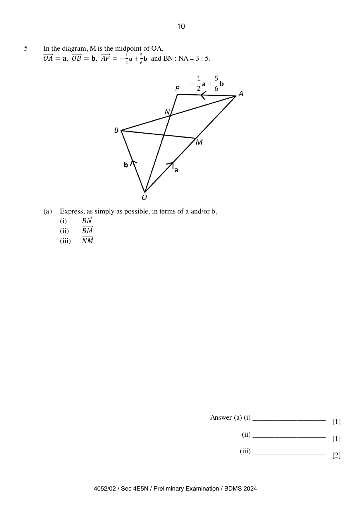

## Question

> **Marks:** 10
> **Page:** 10–11

In the diagram, $M$ is the midpoint of $OA$.

$$
\overrightarrow{OA}=\mathbf{a},\quad\overrightarrow{OB}=\mathbf{b},\quad\overrightarrow{AP}=-\frac{1}{2}\mathbf{a}+\frac{5}{6}\mathbf{b}
$$

and $BN:NA=3:5$.

**(a)** Express, as simply as possible, in terms of $\mathbf{a}$ and/or $\mathbf{b}$,

**(i)** $\overrightarrow{BN}$ [1]

**(ii)** $\overrightarrow{BM}$ [1]

**(iii)** $\overrightarrow{NM}$ [2]

**(b)** Find

$$
\frac{\text{Area of }\triangle OBM}{\text{Area of }\triangle OBA}.
$$

[1]

**(c)** If $ONAC$ is a parallelogram, find $\overrightarrow{CA}$. [2]

**(d)** Given that $\dfrac{OP}{ON}=k$, find the value of $k$. [3]

## Answer Scheme

**(a) (i)**

$$
\overrightarrow{BN}=\frac{3}{8}\overrightarrow{BA}=\frac{3}{8}\mathbf{a}-\frac{3}{8}\mathbf{b}
$$

[B1]

**(ii)**

$$
\overrightarrow{BM}=\frac{1}{2}\mathbf{a}-\mathbf{b}
$$

[B1]

**(iii)**

$$
\overrightarrow{NM}=\overrightarrow{NB}+\overrightarrow{BM}=-\frac{3}{8}\mathbf{a}+\frac{3}{8}\mathbf{b}+\frac{1}{2}\mathbf{a}-\mathbf{b}
$$

[M1]

$$
=\frac{1}{8}\mathbf{a}-\frac{5}{8}\mathbf{b}
$$

[A1]

**(b)**

$$
\frac{\text{Area of }\triangle OBM}{\text{Area of }\triangle OBA}=\frac{1}{2}
$$

[B1]

**(c)**

$$
\overrightarrow{CA}=\overrightarrow{ON}=\overrightarrow{OB}+\overrightarrow{BN}=\mathbf{b}+\frac{3}{8}\mathbf{a}-\frac{3}{8}\mathbf{b}
$$

[M1]

$$
=\frac{3}{8}\mathbf{a}+\frac{5}{8}\mathbf{b}
$$

[A1]

**(d)**

$$
\overrightarrow{OP}=\overrightarrow{OA}+\overrightarrow{AP}=\mathbf{a}-\frac{1}{2}\mathbf{a}+\frac{5}{6}\mathbf{b}=\frac{1}{2}\mathbf{a}+\frac{5}{6}\mathbf{b}=\frac{1}{6}(3\mathbf{a}+5\mathbf{b})
$$

[M1]

$$
\overrightarrow{ON}=\frac{3}{8}\mathbf{a}+\frac{5}{8}\mathbf{b}=\frac{1}{8}(3\mathbf{a}+5\mathbf{b})
$$

$$
\frac{OP}{ON}=\frac{\frac{1}{6}(3\mathbf{a}+5\mathbf{b})}{\frac{1}{8}(3\mathbf{a}+5\mathbf{b})}=\frac{4}{3}
$$

[M1]

$$
k=\frac{4}{3}
$$

[A1]
