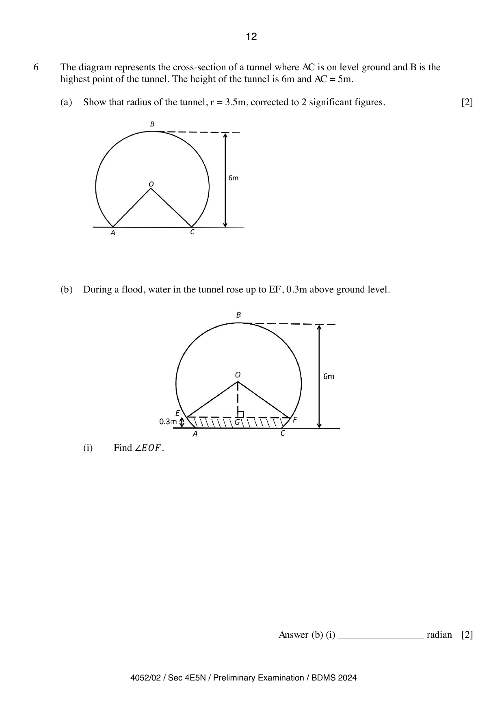

## Question

> **Marks:** 11
> **Page:** 12–13

The diagram represents the cross-section of a tunnel where $AC$ is on level ground and $B$ is the highest point of the tunnel. The height of the tunnel is $6\text{ m}$ and $AC=5\text{ m}$.

**(a)** Show that the radius of the tunnel, $r=3.5\text{ m}$, corrected to $2$ significant figures. [2]

**(b)** During a flood, water in the tunnel rose up to $EF$, $0.3\text{ m}$ above ground level. The second diagram on the page shows chord $EF$, with $G$ the foot of the perpendicular from $O$ to $EF$, and the water region below $EF$ shaded.

**(i)** Find $\angle EOF$. [2]

**(ii)** Find the length of the major arc $EBF$. [2]

**(iii)** Find the cross-section area of the tunnel which is dry. [3]

**(iv)** Given that the length of the tunnel is $1.4\text{ km}$, find the volume of the tunnel which is dry. [2]

## Answer Scheme

**(a)** Show that $r=3.5\text{ m}$, corrected to $2$ significant numbers.

$$
(6-r)^{2}+2.5^{2}=r^{2}
$$

[M1]

$$
36-12r+r^{2}+6.25=r^{2}
$$

$$
12r=42.25
$$

$$
r=3.5\text{ cm (shown)}
$$

[A1]

**(b) (i)**

$$
\frac{1}{2}\angle EOF=\cos^{-1}\left(\frac{6-3.5-0.3}{3.5}\right)
$$

[M1]

$$
\frac{1}{2}\angle EOF=\cos^{-1}\left(\frac{2.2}{3.5}\right)
$$

$$
\angle EOF=1.78216\text{ rad}=1.78\text{ rad (3 s.f.)}
$$

[A1]

**(ii)**

$$
3.5(2\pi-1.78216)=15.8\text{ m}
$$

[M1], [A1]

**(iii)**

$$
\frac{1}{2}(3.5^{2})(2\pi-1.78216)+\frac{1}{2}(3.5^{2})\sin 1.78216
$$

[M1], [M1]

$$
=33.55747=33.6\text{ m}^{2}\text{ (3 s.f.)}
$$

[A1]

**(iv)**

$$
33.55747\times 1400
$$

[M1]

$$
=47000\text{ m}^{3}\text{ (3 s.f.)}
$$

[A1]
