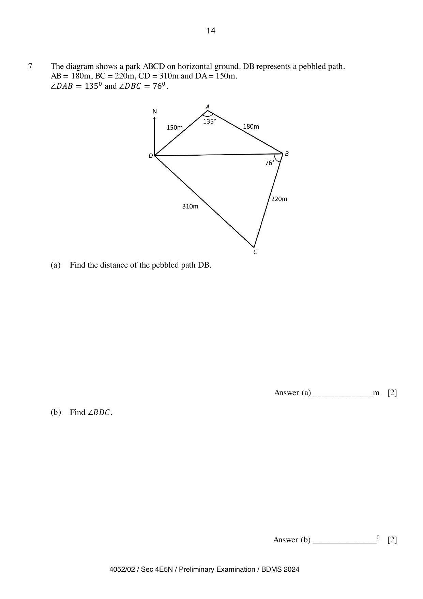

## Question

> **Marks:** 11
> **Page:** 14–15

The diagram shows a park $ABCD$ on horizontal ground. $DB$ represents a pebbled path. $AB=180\text{ m}$, $BC=220\text{ m}$, $CD=310\text{ m}$ and $DA=150\text{ m}$. $\angle DAB=135^{\circ}$ and $\angle DBC=76^{\circ}$.

**(a)** Find the distance of the pebbled path $DB$. [2]

**(b)** Find $\angle BDC$. [2]

**(c)** Find the shortest distance from $A$ to $DB$. [3]

**(d)** A lamp post, $12\text{ m}$, is erected vertically at $A$. Find the greatest angle of elevation of the top of the lamp post from $DB$. [2]

**(e)** Given that $B$ is due east of $D$, find the bearing of $D$ from $C$. [2]

## Answer Scheme

**(a)**

$$
DB^{2}=150^{2}+180^{2}-2(150)(180)\cos 135^{\circ}
$$

[M1]

$$
DB=305.0963=305\text{ m (3 s.f.)}
$$

[A1]

**(b)**

$$
\frac{\sin\angle BDC}{220}=\frac{\sin 76^{\circ}}{310}
$$

[M1]

$$
\angle BDC=43.5191^{\circ}=43.5^{\circ}\text{ (1 d.p.)}
$$

[A1]

**(c)**

$$
\frac{1}{2}\times 150\times 180\times\sin 135^{\circ}=\frac{1}{2}\times 305.0963\times d
$$

[M1], [M1]

$$
d=62.5766=62.6\text{ m (3 s.f.)}
$$

[A1] (follow through)

**(d)**

$$
\tan^{-1}\left(\frac{12}{62.5766}\right)=10.9^{\circ}\text{ (1 d.p.)}
$$

[M1], [A1] (follow through)

**(e)**

$$
360^{\circ}-(180^{\circ}-90^{\circ}-43.5191^{\circ})=313.5^{\circ}\text{ (1 d.p.)}
$$

[M1], [A1] (follow through)
