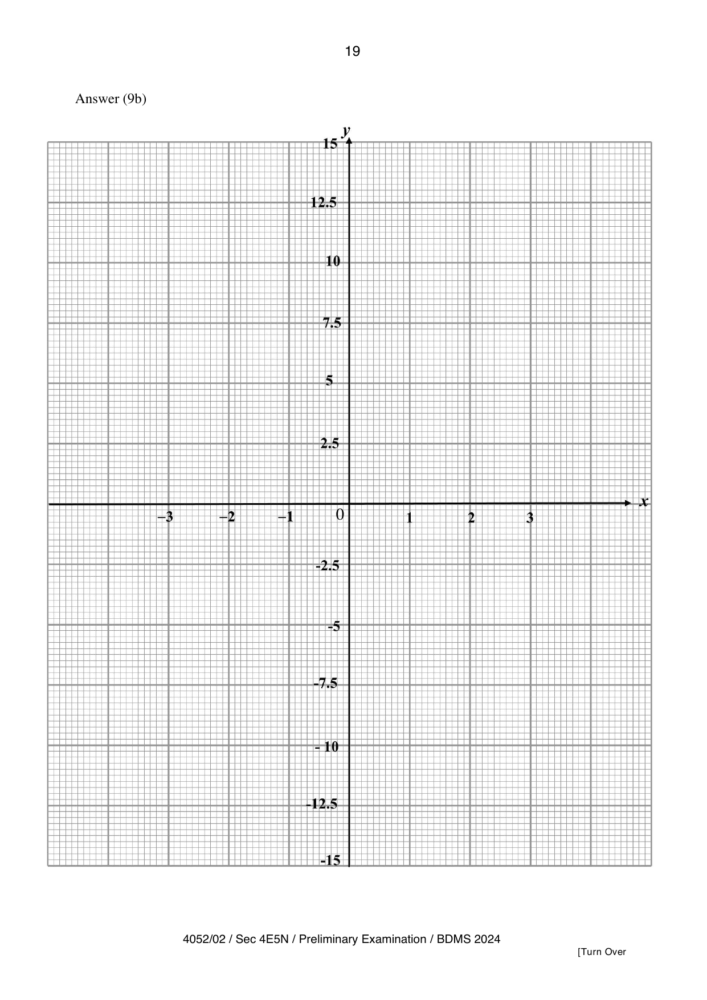
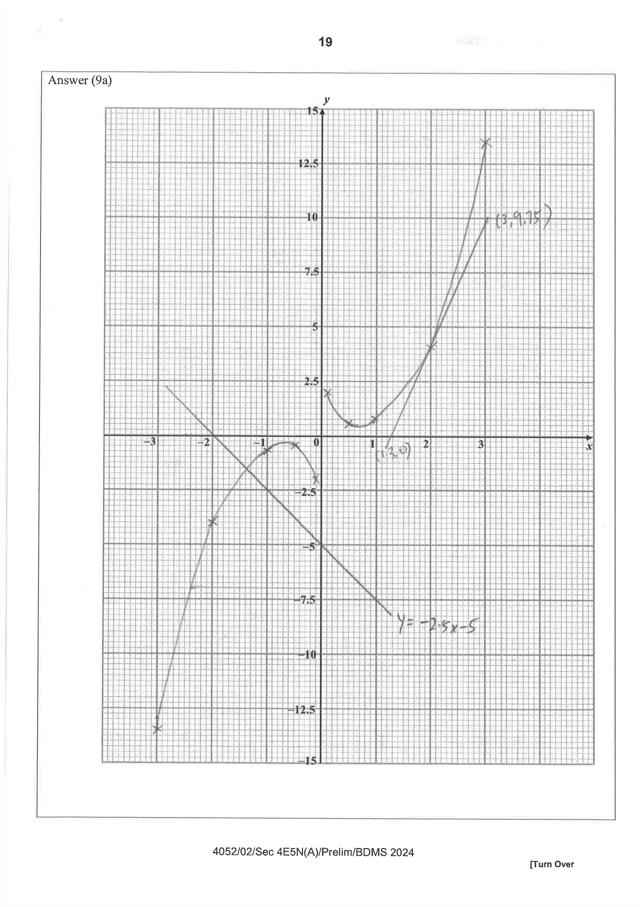

## Question

> **Marks:** 9
> **Page:** 18–19

The variables $x$ and $y$ are connected by the equation

$$
y=\frac{1}{2}x^{3}+\frac{1}{5x}.
$$

Some corresponding values of $x$ and $y$, correct to $1$ decimal place, are given in the table below.

| $x$ | $-3$ | $-2$ | $-1$ | $-0.5$ | $-0.1$ | $0.1$ | $0.5$ | $1$ | $2$ | $3$ |
| --- | --- | --- | --- | --- | --- | --- | --- | --- | --- | --- |
| $y$ | $-13.6$ | $p$ | $-0.7$ | $-0.5$ | $-2.0$ | $2.0$ | $0.5$ | $0.7$ | $4.1$ | $13.6$ |

**(a)** Calculate the value of $p$. [1]

**(b)** On the axes given on page 19, draw the graph of $y=\dfrac{1}{2}x^{3}+\dfrac{1}{5x}$. [2]

**(c)** Using your graph, find the $y$ when $x=-2.4$. [1]

**(d)** By drawing a tangent, find the gradient of the curve at $x=2$. [2]

**(e)** By drawing a suitable straight line, find the solution of

$$
\frac{1}{2}x^{3}+\frac{1}{5x}+2.5x+5=0.
$$

[2]

**(f)** Explain why the curve does not touch the $y$-axis. [1]

## Answer Scheme

**(a)** $p=-4.1$ [B1]

**(b)** On the axes on page 19, correct points [B1] and a smooth curve [B1]. The drawn graph is the separate Paper 2 graph answer.

**(c)** $y=-7\pm 0.25$ [B1]

**(d)** Tangent drawn [M1]. Gradient $=6\pm 2$ [A1]

**(e)** Line $y=-2.5x-5$ [M1]. $x=-1.4\pm 0.1$ [A1]

**(f)** At the $y$-axis, $x=0$, so the curve is undefined. [B1]

