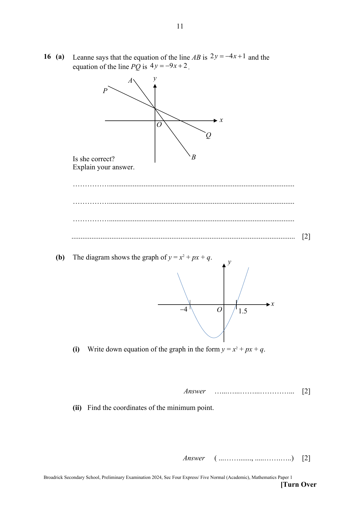

## Question

> **Marks:** (a) 2, (b)(i) 2, (b)(ii) 2; total 6
> **Page:** 11

**(a)** Leanne says that the equation of the line $AB$ is $2y=-4x+1$ and the equation of the line $PQ$ is $4y=-9x+2$.

Is she correct?
Explain your answer.

**(b)** The diagram shows the graph of $y=x^{2}+px+q$. The curve crosses the $x$-axis at $-4$ and $1.5$.

**(i)** Write down equation of the graph in the form $y=x^{2}+px+q$.

**(ii)** Find the coordinates of the minimum point.

## Answer Scheme

**(a)** $2y=-4x+1$ (M1, rearrange to find gradient of either line)

AB: $y=-2x+\dfrac{1}{2}$

$4y=-9x+2$

PQ: $y=-\dfrac{9}{4}x+\dfrac{1}{2}$

The gradient of $PQ$ should be steeper than that of $AB$.
Hence she is not correct. (A1, compare both gradients and conclude)

**(b)(i)** $y=(x+4)(x-1.5)$ (M1)

$y=x^{2}+2.5x-6$ (A1)

**(b)(ii)** Minimum point $(-1.25,-7.5625)$ (B1, B1)
