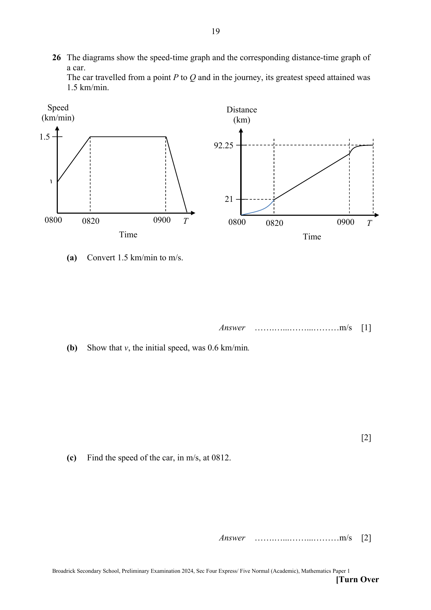

## Question

> **Marks:** (a) 1, (b) 2, (c) 2, (d) 2; total 7
> **Page:** 19–20

The diagrams show the speed-time graph and the corresponding distance-time graph of a car.
The car travelled from a point $P$ to $Q$ and in the journey, its greatest speed attained was 1.5 km/min.

On the speed-time graph, speed rises linearly from $v$ at 0800 to 1.5 km/min at 0820, stays at 1.5 km/min until 0900, then falls linearly to 0 at time $T$.
On the distance-time graph, distance is 0 at 0800, 21 km at 0820, and 92.25 km at time $T$. The graph is curved from 0800 to 0820, straight from 0820 to 0900, then curved up to 92.25 km.

**(a)** Convert 1.5 km/min to m/s.

**(b)** Show that $v$, the initial speed, was 0.6 km/min.

**(c)** Find the speed of the car, in m/s, at 0812.

**(d)** The total distance travelled by the car is 92.25 km.
Find the time, $T$, when it comes to a complete stop.

## Answer Scheme

**(a)** 1.5 km/min

$=\dfrac{1.5\times 1000}{1\times 60}=25\text{ m/s}$ (B1)

**(b)** Area = distance travelled

$21=\dfrac{1}{2}(v+1.5)(20)$ (M1)

$21=10(v+1.5)$

$2.1=v+1.5$

$v=0.6$ (A1)

**(c)** $\dfrac{\text{speed}-0.6}{12}=\dfrac{1.5-0.6}{20}$ (M1)

$\dfrac{\text{speed}-0.6}{12}=0.045$

speed $=1.14\text{ km/min}=19\text{ m/s}$ (A1)

Or acceleration $=\dfrac{1.5-0.6}{20}=0.045$,

speed $=0.6+12(0.045)=1.14\text{ km/min}=19\text{ m/s}$.

**(d)** Area = distance travelled

$92.25=\dfrac{1}{2}(0.6+1.5)(20)+1.5(40)+\dfrac{1}{2}(t)(1.5)$ (M1)

$92.25=21+60+0.75t$

$11.25=0.75t$

$t=15\text{ min}$

$T$ is 0915 (A1)
