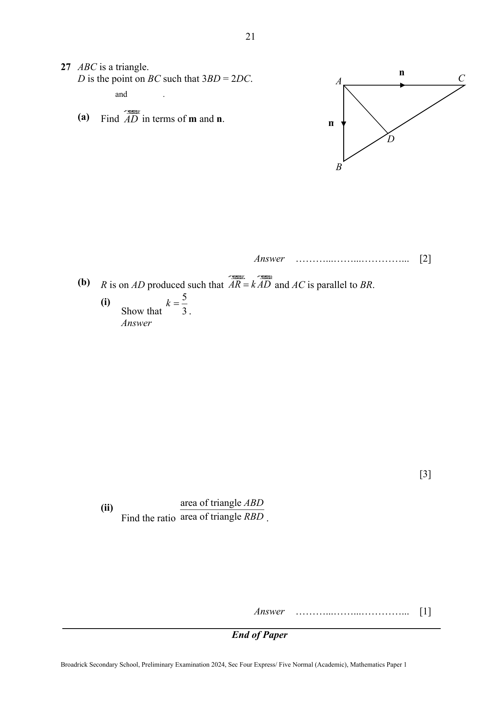

## Question

> **Marks:** (a) 2, (b)(i) 3, (b)(ii) 1; total 6
> **Page:** 21

$ABC$ is a triangle.
$D$ is the point on $BC$ such that $3BD=2DC$.

The printed statement after “and” is not visible. The diagram shows an arrow along $AC$ and an arrow along $AB$.

**(a)** Find $\overrightarrow{AD}$ in terms of $\mathbf{m}$ and $\mathbf{n}$.

**(b)** $R$ is on $AD$ produced such that $\overrightarrow{AR}=k\overrightarrow{AD}$ and $AC$ is parallel to $BR$.

**(i)** Show that $k=\dfrac{5}{3}$.

**(ii)** Find the ratio $\dfrac{\text{area of triangle }ABD}{\text{area of triangle }RBD}$.

## Answer Scheme

**(a)** $\dfrac{BD}{DC}=\dfrac{2}{3}$ because $3BD=2DC$

$\overrightarrow{AD}=\overrightarrow{AB}+\dfrac{2}{5}\overrightarrow{BC}$

$=\mathbf{m}+\dfrac{2}{5}(-\mathbf{m}+\mathbf{n})$ (M1)

$=\dfrac{3}{5}\mathbf{m}+\dfrac{2}{5}\mathbf{n}$ (A1)

**(b)(i)** $\overrightarrow{AR}=k\overrightarrow{AD}=\dfrac{3}{5}k\mathbf{m}+\dfrac{2}{5}k\mathbf{n}$ (M1)

$\overrightarrow{BR}=\overrightarrow{BA}+\overrightarrow{AR}$

$=-\mathbf{m}+\dfrac{3}{5}k\mathbf{m}+\dfrac{2}{5}k\mathbf{n}$

$=\left(\dfrac{3}{5}k-1\right)\mathbf{m}+\dfrac{2}{5}k\mathbf{n}$ (M1)

Since $AC$ is parallel to $BR$ and $\overrightarrow{AC}=\mathbf{n}$, (A1)

$\dfrac{3}{5}k-1=0$

$k=\dfrac{5}{3}$

**(b)(ii)** $\dfrac{\text{area of triangle }ABD}{\text{area of triangle }RBD}=\dfrac{AD}{DR}$

$=\dfrac{3}{2}$ (A1)
