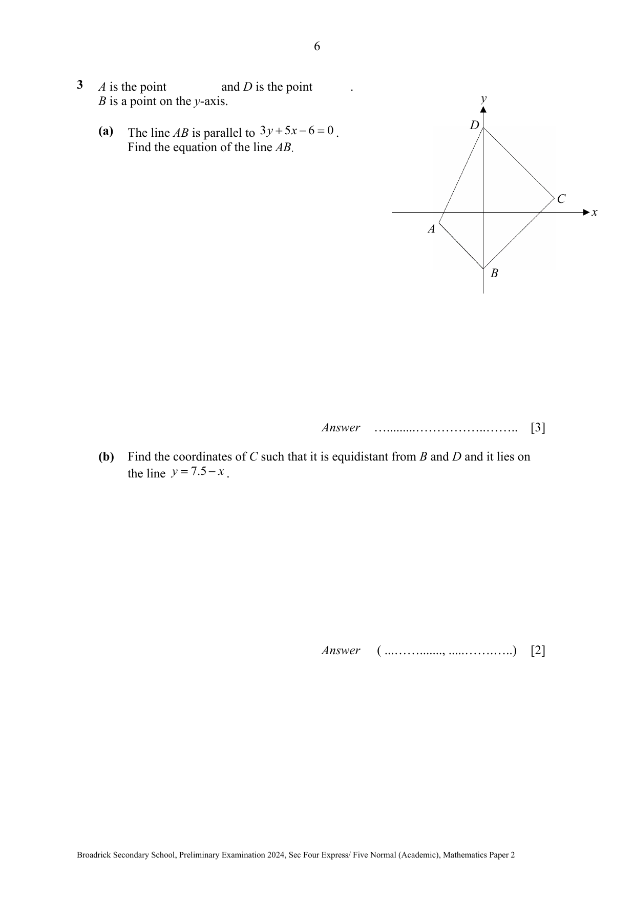

## Question

> **Marks:** (a) 3, (b) 2, (c) 2, (d) 3; total 10
> **Page:** 6–7

$A$ is the point [unclear] and $D$ is the point [unclear].
$B$ is a point on the $y$-axis.

The coordinates of $A$ and of $D$ are not visible. The diagram shows $A$ to the left of the origin, $D$ on the positive $y$-axis, $B$ on the negative $y$-axis and $C$ in the first quadrant, with $ABCD$ a kite symmetric about the $y$-axis.

**(a)** The line $AB$ is parallel to $3y+5x-6=0$.
Find the equation of the line $AB$.

**(b)** Find the coordinates of $C$ such that it is equidistant from $B$ and $D$ and it lies on the line $y=7.5-x$.

**(c)** Find the area of the quadrilateral $ABCD$.

**(d)** Find the size of angle $ABC$.

## Answer Scheme

**(a)** $3y+5x-6=0$

$y=-\dfrac{5}{3}x+2$ (M1, find gradient)

$-1=-\dfrac{5}{3}(-3)+c$ (M1)

$c=-6$

$y=-\dfrac{5}{3}x-6$ (A1)

**(b)** $y=-\dfrac{5}{3}(0)-6=-6$

$B(0,-6)$

Midpoint of $BD=\left(0,\dfrac{9+(-6)}{2}\right)=(0,1.5)$ (M1, find the $y$-value of $C$)

$C$ is $(x,1.5)$ and substitute into $y=7.5-x$

$1.5=7.5-x$

$x=6$

So $C$ is $(6,1.5)$ (A1)

**(c)** Area $=\dfrac{1}{2}(15)(3)+\dfrac{1}{2}(15)(6)$ (M1)

$=67.5$ (A1, ECF from (b))

**(d)** Let $P$ be $(0,-1)$.

$\tan\angle ABP=\dfrac{3}{5}$ (M1)

$\angle ABP=\tan^{-1}\left(\dfrac{3}{5}\right)$

Let $Q$ be $(0,1.5)$.

$\tan\angle CBQ=\dfrac{6}{7.5}$ (M1)

$\angle CBQ=\tan^{-1}\left(\dfrac{6}{7.5}\right)$

$\angle ABC=\tan^{-1}\left(\dfrac{3}{5}\right)+\tan^{-1}\left(\dfrac{6}{7.5}\right)$

$=69.6^{\circ}$ (A1)

Or find the lengths of $AB$, $BC$ and $AC$ and use the cosine rule.
