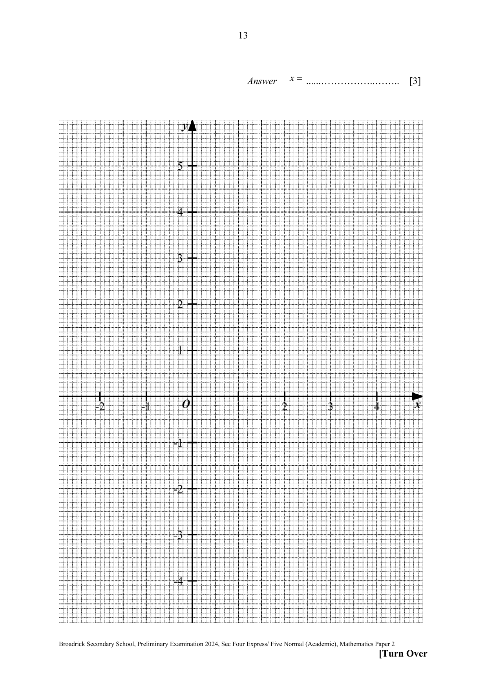

## Question

> **Marks:** (a) 1, (b) 3, (c)(i) 1, (c)(ii) 2, (d) 3; total 10
> **Page:** 12–13

**(a)** Complete the table of values for $y=\dfrac{1}{x-1}+x-1$.

| $x$ | $-2$ | $-1$ | $0$ | $0.5$ | $0.75$ | $1.25$ | $1.5$ | $2$ | $3$ | $3.5$ | $4$ |
| --- | --- | --- | --- | --- | --- | --- | --- | --- | --- | --- | --- |
| $y$ | | $-2.5$ | $-2$ | $-2.5$ | $-4.25$ | $4.25$ | $2.5$ | $2$ | $2.5$ | $2.9$ | $3.33$ |

The $y$-value for $x=-2$ is blank on the paper.

**(b)** On the grid opposite, draw the graph of $y=\dfrac{1}{x-1}+x-1$ for $-2\leq x\leq 4$.

**(c)** The point $P$ has the coordinates $(-1,2)$.
A tangent to the curve can be drawn so that the tangent passes through $P$ and its gradient $<0$.

**(i)** Draw this tangent on the same grid.

**(ii)** Find the equation of this tangent.

**(d)** By drawing an appropriate line, use your graph to solve the equation $\dfrac{1}{x-1}-\dfrac{1}{4}x=0$ in the range $-2\leq x\leq 4$.

## Answer Scheme

**(a)** $-3.33$ (2dp) (B1)

**(b)** All points plotted correctly (P2)

Smooth curve (C1)

**(c)(i)** Tangent drawn such that it passes through $(-1,2)$ and touches the curve at 1 point and the gradient is negative. (C1)

**(c)(ii)** $m=\dfrac{2-(-1)}{-1-0}=-3$ (M1)

$c=-1$

$y=-3x-1$ (A1)

**(d)** $\dfrac{1}{x-1}-\dfrac{1}{4}x=0$

$\dfrac{1}{x-1}-\dfrac{1}{4}x+\dfrac{5}{4}x-1=\dfrac{5}{4}x-1$ (M1)

$y=\dfrac{5}{4}x-1$ (M1)

Draw the line on the graph. (A1)

$x=2.6$ (accept $2.5$, $2.55$) and $x=-1.5$ (accept $-1.4$, $-1.45$, $-1.55$, $-1.6$)
