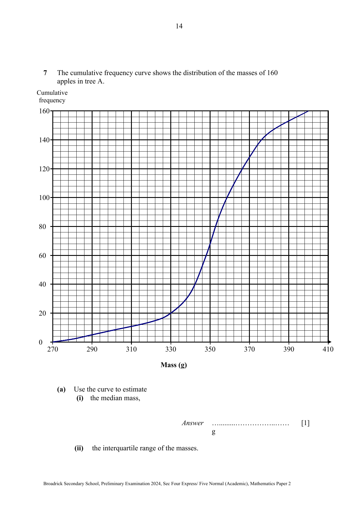
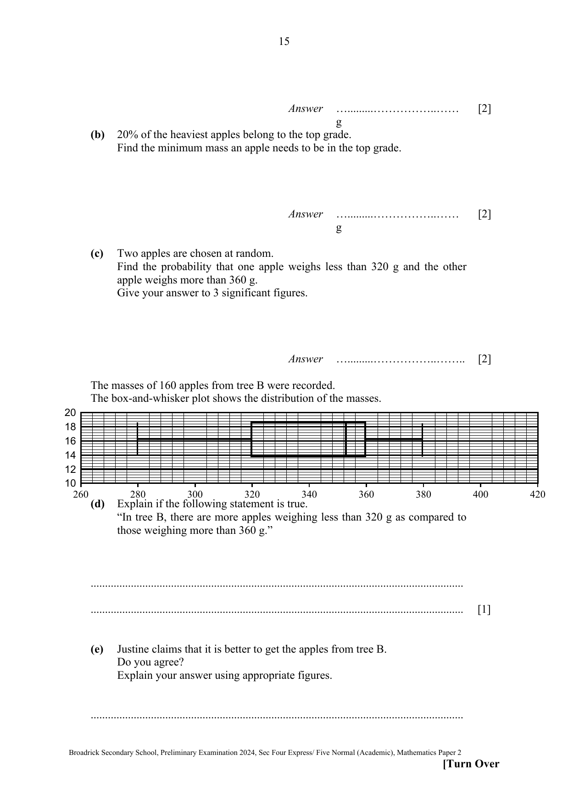

## Question

> **Marks:** (a)(i) 1, (a)(ii) 2, (b) 2, (c) 2, (d) 1, (e) 2; total 10
> **Page:** 14–16

The cumulative frequency curve shows the distribution of the masses of 160 apples in tree A.

**(a)** Use the curve to estimate

**(i)** the median mass,

**(ii)** the interquartile range of the masses.

**(b)** 20% of the heaviest apples belong to the top grade.
Find the minimum mass an apple needs to be in the top grade.

**(c)** Two apples are chosen at random.
Find the probability that one apple weighs less than 320 g and the other apple weighs more than 360 g.
Give your answer to 3 significant figures.

The masses of 160 apples from tree B were recorded.
The box-and-whisker plot shows the distribution of the masses.

**(d)** Explain if the following statement is true.
“In tree B, there are more apples weighing less than 320 g as compared to those weighing more than 360 g.”

**(e)** Justine claims that it is better to get the apples from tree B.
Do you agree?
Explain your answer using appropriate figures.

## Answer Scheme

**(a)(i)** Median $=353\text{ g}$ (B1)

**(a)(ii)** Upper quartile: 366 or 367

Lower quartile: 342 or 343

IQR $=366-342$ (M1)

$=24\text{ g}$ (also accept 23 or 25 g depending on their upper and lower quartiles) (A1)

**(b)** $20\%\rightarrow 32$ apples (M1)

Read at the 128th apple.

Minimum mass $=370\text{ g}$ (A1)

**(c)** $\dfrac{14}{160}\times\dfrac{160-104}{159}\times 2$ (M1)

$=0.0616$ (A1)

**(d)** False.

The first quartile, which represents 25% of the apples, is less than 320 g.
The upper quartile, which represents 75% of the apples, is less than 360 g, which implies that 25% of the apples are more than 360 g. (B1, states that the whiskers represent 25% of the data)

Hence there are an equal number of apples weighing less than 320 g and more than 360 g.

**(e)** I disagree.

The median mass of apples from tree A is the same as that from tree B. On average, apples from tree A and B weigh the same. (B1)

IQR (tree B) $=360-320=40\text{ g}$.
However, the interquartile range of the masses of the apples from tree B is bigger than that from tree A. The masses of the apples from tree B have a bigger spread, thus are less consistent. (B1)
