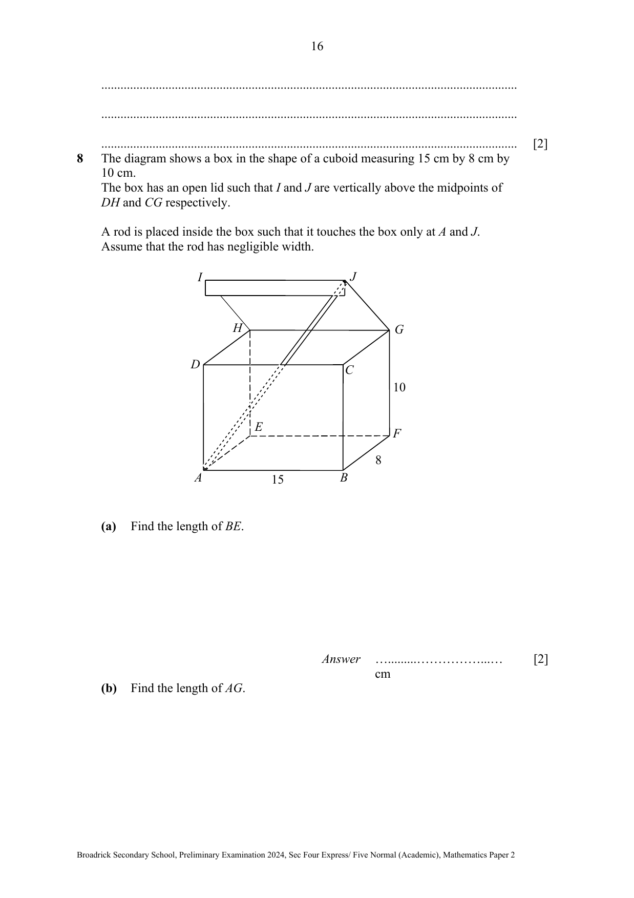

## Question

> **Marks:** (a) 2, (b) 2, (c) 4, (d) 2; total 10
> **Page:** 16–18

The diagram shows a box in the shape of a cuboid measuring 15 cm by 8 cm by 10 cm.
The box has an open lid such that $I$ and $J$ are vertically above the midpoints of $DH$ and $CG$ respectively.

A rod is placed inside the box such that it touches the box only at $A$ and $J$.
Assume that the rod has negligible width.

**(a)** Find the length of $BE$.

**(b)** Find the length of $AG$.

**(c)** Show that the length of the rod, $AJ$, is 22.97 cm, correct to 4 significant figures.

**(d)** Find angle $JAG$.

## Answer Scheme

**(a)** $BE=\sqrt{15^{2}+8^{2}}$ (M1)

$=17\text{ cm}$ (A1)

**(b)** $AG=\sqrt{17^{2}+10^{2}}=\sqrt{389}$ (M1)

$=19.7\text{ cm}$ (3sf) (A1)

**(c)** Let $M$ be the midpoint of $CG$ and $N$ be the midpoint of $BF$. (M1)

$JM=\sqrt{8^{2}-4^{2}}=\sqrt{48}$ (M1)

Then $JN=10+\sqrt{48}$

$AN=\sqrt{15^{2}+4^{2}}=\sqrt{241}$ (M1)

$AJ^{2}=(\sqrt{241})^{2}+(10+\sqrt{48})^{2}$

$AJ=22.96876=22.97$ (4sf) (shown) (A1)

**(d)** $\cos\angle JAG=\dfrac{22.97^{2}+(\sqrt{389})^{2}-8^{2}}{2\times 22.97\times\sqrt{389}}$ (M1)

$\angle JAG=19.7796^{\circ}=19.8^{\circ}$ (1dp) (A1)

If the exact value is used, the angle is $19.78165^{\circ}=19.8^{\circ}$ (1dp).
