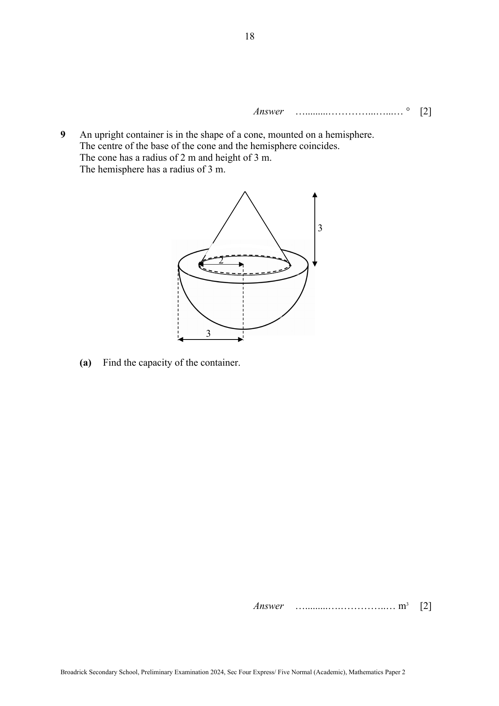

## Question

> **Marks:** (a) 2, (b) 5; total 7
> **Page:** 18–19

An upright container is in the shape of a cone, mounted on a hemisphere.
The centre of the base of the cone and the hemisphere coincides.
The cone has a radius of 2 m and height of 3 m.
The hemisphere has a radius of 3 m.

**(a)** Find the capacity of the container.

**(b)** There is a tap on the vertex of the cone.
The container is filled with water such that the hemisphere and 90% of the cone are filled.
Find the area which the water is in contact with the container.

## Answer Scheme

**(a)** Capacity $=\dfrac{1}{3}\pi(2)^{2}(3)+\dfrac{2}{3}\pi(3)^{3}$ (M1)

$=69.1150=69.1\text{ m}^{3}$ (A1)

**(b)** Curved hemisphere $=2\pi(3)^{2}=18\pi$ (M1, hemisphere or ring)

Ring $=\pi(3)^{2}-\pi(2)^{2}=5\pi$

Slant height of cone, $L=\sqrt{2^{2}+3^{2}}=\sqrt{13}$ (M1, curved surface area of the big cone using their $L$)

Curved area of big cone $=\pi(2)\sqrt{13}=2\pi\sqrt{13}$

Using similar solids,

$\dfrac{h_{\text{small cone}}}{h_{\text{big cone}}}=\sqrt[3]{\dfrac{1}{10}}$ (M1, find ratio of heights and then area)

$\dfrac{A_{\text{small cone}}}{A_{\text{big cone}}}=\left(\sqrt[3]{\dfrac{1}{10}}\right)^{2}=\dfrac{1}{\sqrt[3]{100}}$

$\dfrac{A_{\text{contact with water}}}{A_{\text{big cone}}}=\dfrac{\sqrt[3]{100}-1}{\sqrt[3]{100}}$

$A_{\text{contact with water}}=\dfrac{\sqrt[3]{100}-1}{\sqrt[3]{100}}\times 2\pi\sqrt{13}=17.7736$ (M1, find area of cone in contact)

Total area in contact $=18\pi+5\pi+17.7736$

$=90.0302=90.0\text{ m}^{2}$ (A1)
