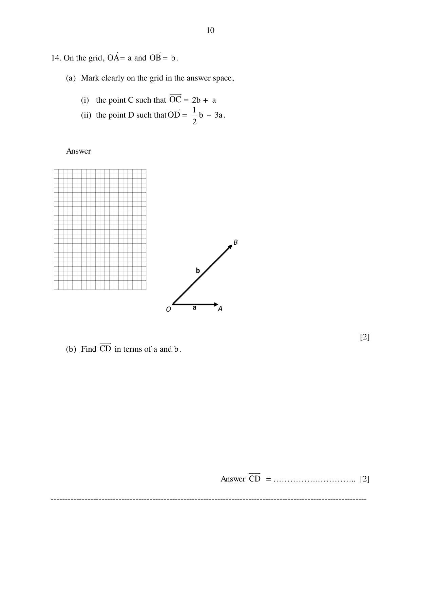
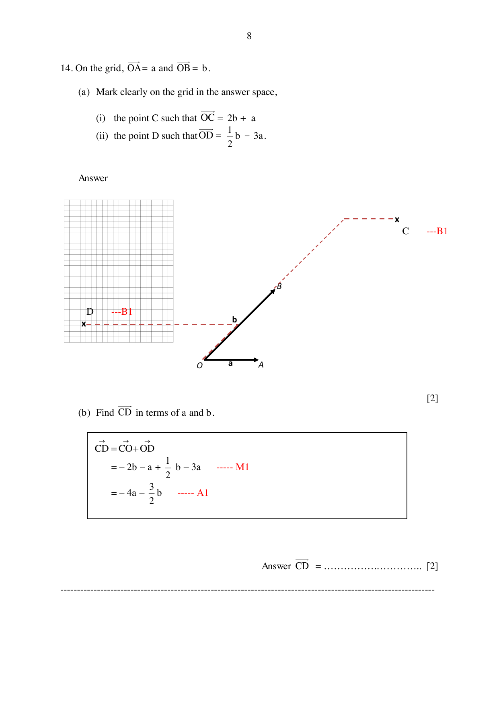

## Question

> **Marks:** 4
> **Page:** 10

On the grid, $\overrightarrow{OA} = \mathbf{a}$ and $\overrightarrow{OB} = \mathbf{b}$.

(a) Mark clearly on the grid in the answer space,

(i) the point $C$ such that $\overrightarrow{OC} = 2\mathbf{b}+\mathbf{a}$

(ii) the point $D$ such that $\overrightarrow{OD} = \dfrac{1}{2}\mathbf{b}-3\mathbf{a}$. [2]

(b) Find $\overrightarrow{CD}$ in terms of $\mathbf{a}$ and $\mathbf{b}$. [2]

## Answer Scheme

(a) On the grid, $C$ is marked at $\mathbf{a}+2\mathbf{b}$. B1. $D$ is marked at $-3\mathbf{a}+\dfrac{1}{2}\mathbf{b}$. B1.

(b)

$$
\overrightarrow{CD} = \overrightarrow{CO}+\overrightarrow{OD}
$$

$$
= -2\mathbf{b}-\mathbf{a}+\frac{1}{2}\mathbf{b}-3\mathbf{a} \quad\text{M1}
$$

$$
= -4\mathbf{a}-\frac{3}{2}\mathbf{b} \quad\text{A1}
$$
