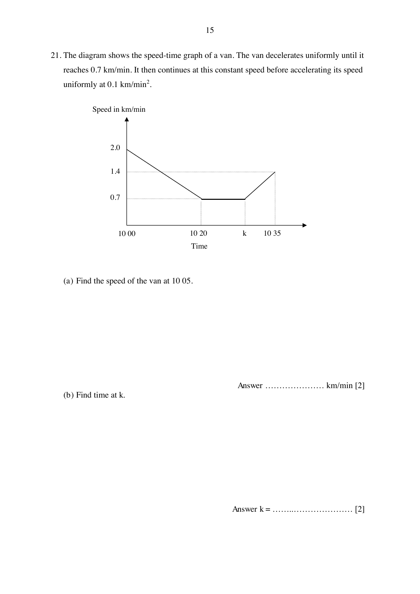

## Question

> **Marks:** 4
> **Page:** 15

The diagram shows the speed-time graph of a van. The van decelerates uniformly until it reaches $0.7\text{ km/min}$. It then continues at this constant speed before accelerating its speed uniformly at $0.1\text{ km/min}^{2}$.

The graph starts at $2.0\text{ km/min}$ at 10 00, falls in a straight line to $0.7\text{ km/min}$ at 10 20, stays at $0.7\text{ km/min}$ until time $k$, then rises in a straight line to $1.4\text{ km/min}$ at 10 35. A horizontal guide is drawn at $1.4\text{ km/min}$.

(a) Find the speed of the van at 10 05. [2]

(b) Find time at $k$. [2]

## Answer Scheme

The van decelerates uniformly until $0.7\text{ km/min}$, continues at this constant speed until time $k$, then accelerates uniformly at $0.1\text{ km/min}^{2}$.

(a)

$$
\text{Deceleration} = \frac{2-0.7}{20} = 0.065\text{ km/min}^{2} \quad\text{M1}
$$

$$
\text{Speed at 10 05} = 2-(5\times 0.065) = 1.675\text{ km/min} \quad\text{A1}
$$

Accept $1\dfrac{27}{40}$.

(b)

$$
\frac{1.4-0.7}{T} = 0.1 \quad\text{M1}
$$

$$
T = 7\text{ min}
$$

$$
k = 10\,35\text{ h}-7\text{ min} = 10\,28\text{ h} \quad\text{A1}
$$
