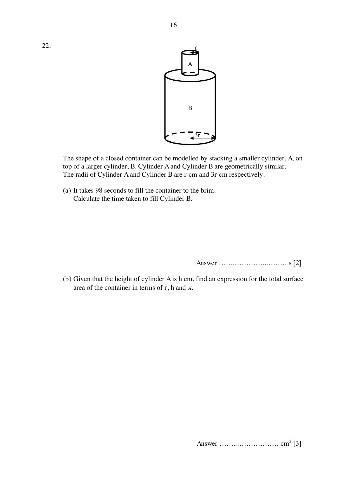

## Question

> **Marks:** 5
> **Page:** 16

The shape of a closed container can be modelled by stacking a smaller cylinder, A, on top of a larger cylinder, B. Cylinder A and Cylinder B are geometrically similar. The radii of Cylinder A and Cylinder B are $r\text{ cm}$ and $3r\text{ cm}$ respectively.

(a) It takes 98 seconds to fill the container to the brim. Calculate the time taken to fill Cylinder B. [2]

(b) Given that the height of cylinder A is $h\text{ cm}$, find an expression for the total surface area of the container in terms of $r$, $h$ and $\pi$. [3]

## Answer Scheme

(a)

$$
\frac{r_{A}}{r_{B}} = \frac{1}{3}
$$

$$
\frac{V_{A}}{V_{B}} = \left(\frac{1}{3}\right)^{3} = \frac{1}{27} \quad\text{M1}
$$

$$
\text{Time to fill cylinder B} = \frac{98}{28}\times 27 = 94.5\text{ s} \quad\text{A1}
$$

(b) Two circles plus the curved surface of A plus the curved surface of B. The height of B is $3h$ because the cylinders are similar.

$$
2\pi(3r)^{2}+2\pi rh+2\pi(3r)(3h) \quad\text{M2 (M1 for any 2 correct)}
$$

$$
= 18\pi r^{2}+2\pi rh+18\pi rh = 18\pi r^{2}+20\pi rh \quad\text{A1}
$$
