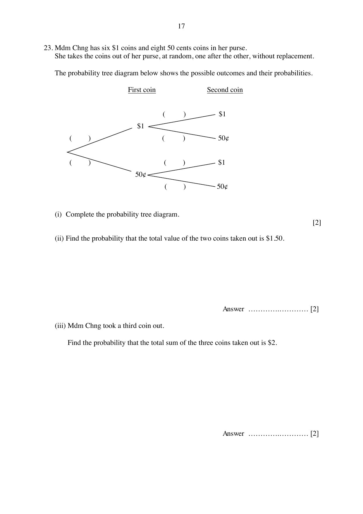

## Question

> **Marks:** 6
> **Page:** 17

Mdm Chng has six ＄1 coins and eight 50 cents coins in her purse. She takes the coins out of her purse, at random, one after the other, without replacement.

The probability tree diagram below shows the possible outcomes and their probabilities. Every probability bracket is blank.

(i) Complete the probability tree diagram. [2]

(ii) Find the probability that the total value of the two coins taken out is ＄1.50. [2]

(iii) Mdm Chng took a third coin out. Find the probability that the total sum of the three coins taken out is ＄2. [2]

## Answer Scheme

(i) First coin: $\dfrac{6}{14} = \dfrac{3}{7}$ for ＄1, and $\dfrac{8}{14} = \dfrac{4}{7}$ for 50 cents. B1.

Second coin after ＄1: $\dfrac{5}{13}$ for ＄1 and $\dfrac{8}{13}$ for 50 cents.

Second coin after 50 cents: $\dfrac{6}{13}$ for ＄1 and $\dfrac{7}{13}$ for 50 cents. B1.

(ii) Probability of ＄1 then 50 cents, or 50 cents then ＄1:

$$
\left(\frac{6}{14}\times\frac{8}{13}\right)+\left(\frac{8}{14}\times\frac{6}{13}\right) = \frac{48}{91} \quad\text{M1, A1}
$$

(iii) Probability of one ＄1 coin and two 50 cent coins:

$$
\left(\frac{6}{14}\times\frac{8}{13}\times\frac{7}{12}\right)\times 3 = \frac{6}{13} \quad\text{M1, A1}
$$
