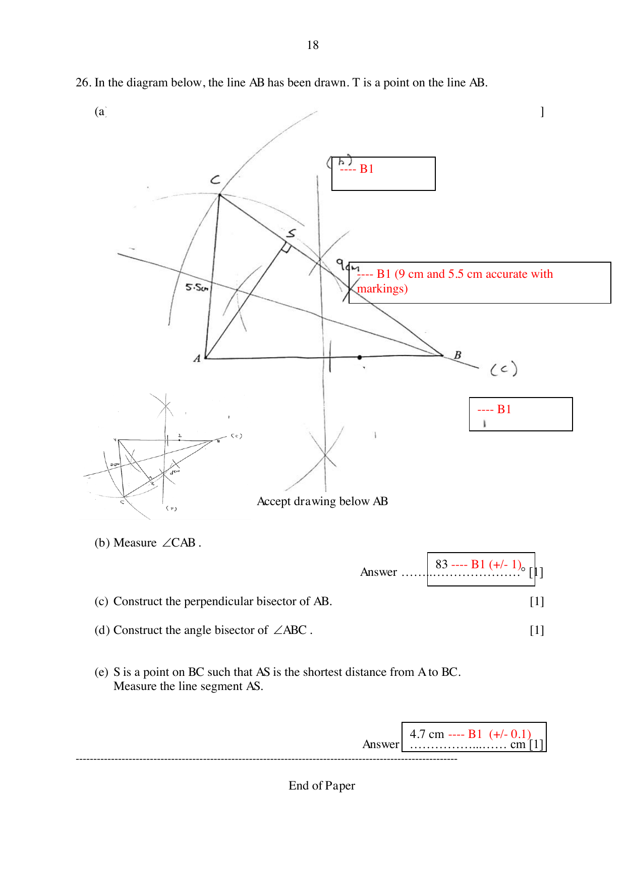

## Question

> **Marks:** 5
> **Page:** 20

In the diagram below, the line segment $AB$ has been drawn.

(a) Construct a triangle $ABC$ such that $BC = 9\text{ cm}$ and $AC = 5.5\text{ cm}$. [1]

(b) Measure $\angle CAB$. [1]

(c) Construct the perpendicular bisector of $AB$. [1]

(d) Construct the angle bisector of $\angle ABC$. [1]

(e) $S$ is a point on $BC$ such that $AS$ is the shortest distance from $A$ to $BC$. Measure the line segment $AS$. [1]

## Answer Scheme

$T$ is a point on the line $AB$. A drawing below $AB$ is accepted.

(a) Triangle constructed. B1. Lengths $9\text{ cm}$ and $5.5\text{ cm}$ accurate, with markings. B1.

(b) $\angle CAB = 83^{\circ}$. B1 ($\pm 1^{\circ}$).

(c) Perpendicular bisector of $AB$. [1]

(d) Angle bisector of $\angle ABC$. [1]

(e) $AS = 4.7\text{ cm}$. B1 ($\pm 0.1\text{ cm}$).
