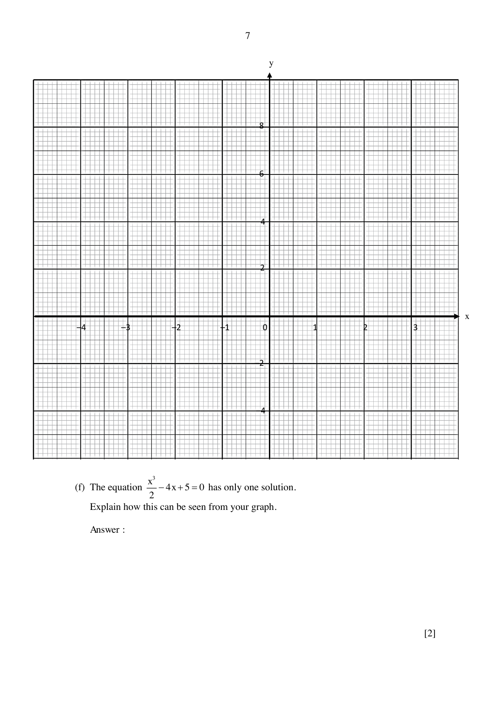

## Question

> **Marks:** 11
> **Page:** 6–7

The variables $x$ and $y$ are connected by the equation $y = \dfrac{x^{3}}{2}-4x+3$. Some corresponding values of $x$ and $y$ are given in the table below.

| $x$ | $-3.5$ | $-3$ | $-2$ | $-1$ | $0$ | $1$ | $2$ | $2.5$ | $3$ |
| --- | --- | --- | --- | --- | --- | --- | --- | --- | --- |
| $y$ | $-4.4$ | $1.5$ | $p$ | $6.5$ | $3$ | $-0.5$ | $-1$ | $0.8$ | $4.5$ |

(a) Find the value of $p$. [1]

(b) On the graph paper found in the next page, draw the graph of $y = \dfrac{x^{3}}{2}-4x+3$ for $-3.5\leq x\leq 3$. [3]

The grid is labelled in steps of 1 on both axes. Each large square is divided into smaller squares.

(c) By drawing a tangent, find the gradient of the curve at $x = 2.5$. [2]

(d) (i) On the same axes, draw the line $y = -x-1$ for $-3.5\leq x\leq 3$. [1]

(ii) Write down the $x$-coordinate of the point where this line intersects the curve. [1]

(e) State the minimum value of $y = \dfrac{x^{3}}{2}-4x+3$ for $0\leq x\leq 3$. [1]

(f) The equation $\dfrac{x^{3}}{2}-4x+5 = 0$ has only one solution. Explain how this can be seen from your graph. [2]
