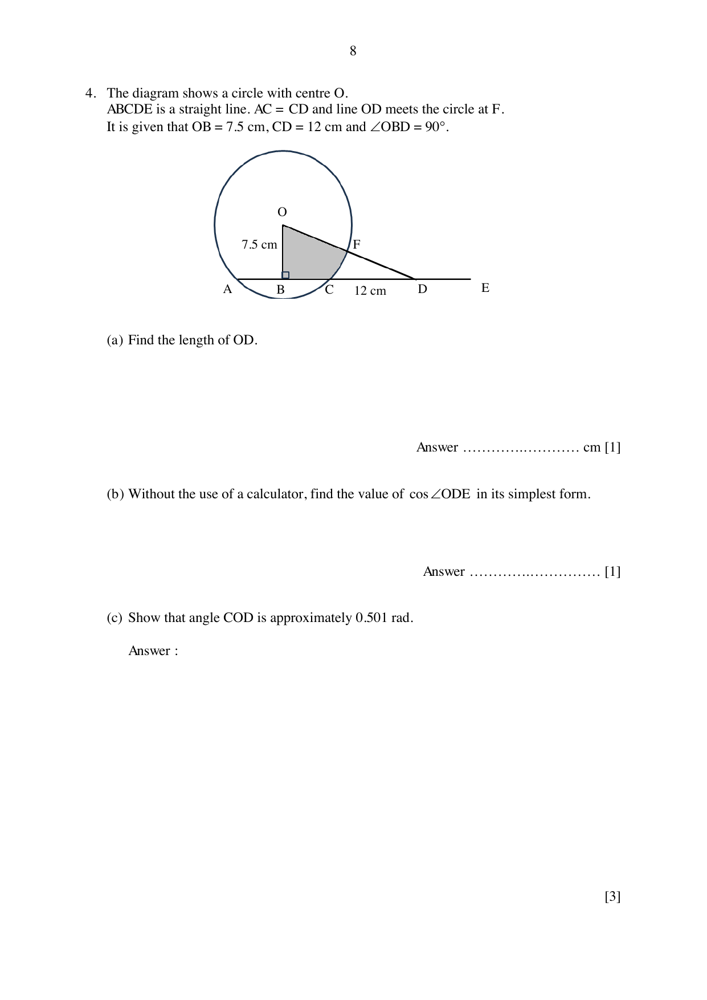

## Question

> **Marks:** 8
> **Page:** 8–9

The diagram shows a circle with centre $O$. $ABCDE$ is a straight line. $AC = CD$ and line $OD$ meets the circle at $F$. It is given that $OB = 7.5\text{ cm}$, $CD = 12\text{ cm}$ and $\angle OBD = 90^{\circ}$.

(a) Find the length of $OD$. [1]

(b) Without the use of a calculator, find the value of $\cos\angle ODE$ in its simplest form. [1]

(c) Show that angle $COD$ is approximately $0.501$ rad. [3]

(d) Find the perimeter of the shaded region. [3]
