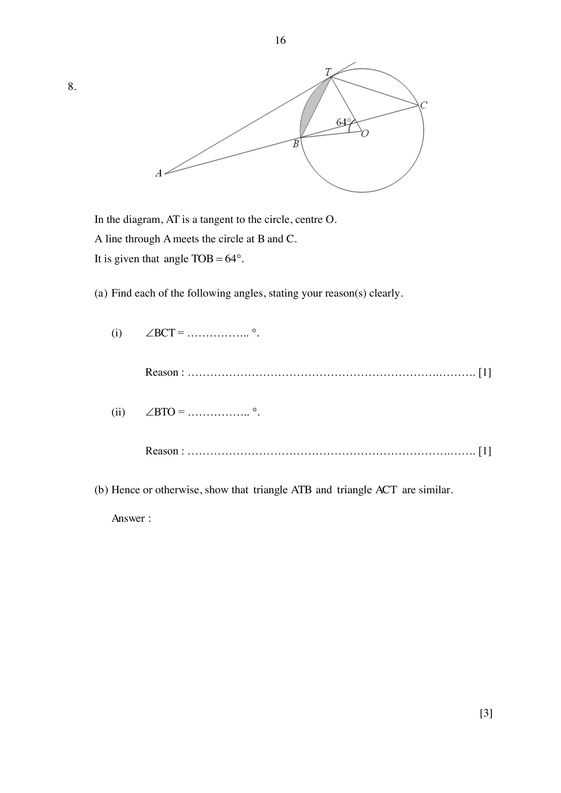

## Question

> **Marks:** 11
> **Page:** 16–17

In the diagram, $AT$ is a tangent to the circle, centre $O$. A line through $A$ meets the circle at $B$ and $C$. It is given that angle $TOB = 64^{\circ}$.

(a) Find each of the following angles, stating your reason(s) clearly.

(i) $\angle BCT$. [1]

(ii) $\angle BTO$. [1]

(b) Hence or otherwise, show that triangle $ATB$ and triangle $ACT$ are similar. [3]

(c) Given that $AB = 4.5\text{ cm}$ and $BC = 3.5\text{ cm}$, find the length of $AT$. [2]

(d) Find the value of $\dfrac{\text{Area }\triangle ABT}{\text{Area }\triangle BCT}$. [1]

(e) Given that the radius of the circle is $1.8\text{ cm}$, find the area of the shaded segment. [3]
