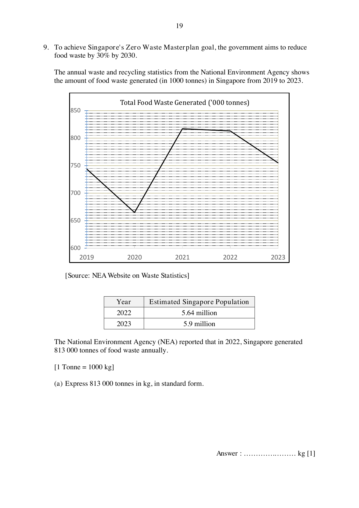

## Question

> **Marks:** 10
> **Page:** 19–21

To achieve Singapore's Zero Waste Masterplan goal, the government aims to reduce food waste by $30\%$ by 2030.

The annual waste and recycling statistics from the National Environment Agency shows the amount of food waste generated (in 1000 tonnes) in Singapore from 2019 to 2023.

The graph falls from about 745 in 2019 to about 665 in 2020, rises to about 815 in 2021, stays near 810 in 2022, then falls to about 755 in 2023. Source: NEA Website on Waste Statistics.

| Year | Estimated Singapore Population |
| --- | --- |
| 2022 | 5.64 million |
| 2023 | 5.9 million |

The National Environment Agency (NEA) reported that in 2022, Singapore generated $813\,000$ tonnes of food waste annually.

$[1\text{ tonne} = 1000\text{ kg}]$

(a) Express $813\,000$ tonnes in kg, in standard form. [1]

(b) Calculate the average mass, in kg, of food waste per person, per day, in 2022. [2]

Mrs Kim's household is made up of 5 persons altogether. The table below shows the estimated average mass of food wastage (in kg) for the three meals in her household in 2022.

| Breakfast | Lunch | Dinner |
| --- | --- | --- |
| $0.25$ | $0.9$ | $1.25$ |

(c) Calculate the average mass, in kg, of food waste per person in Mrs Kim's household, per day, in 2022. [1]

According to NEA, a household of 5 persons can reduce food waste in these 4 ways.

| Ways to reduce food waste | Estimated food waste reduction |
| --- | --- |
| Composting | $4.9\text{ kg}$ per week |
| Utilising leftovers | $175\text{ g}$ per day |
| Keeping track of expiry dates | $0.8\text{ kg}$ per week |
| Proper storage | $2.4\text{ kg}$ per month |

In 2023, Mrs Kim encouraged her family to reduce their food waste by implementing the methods listed above. However, Mrs Kim's household does not have a food composting machine.

(d) Determine if Mrs Kim's household managed to reduce their food waste more effectively than the national average mass. Provide your reasoning and calculations clearly. [6]
